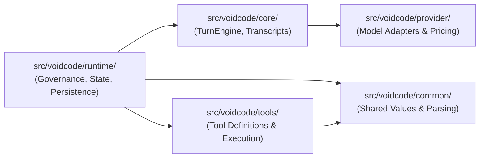

# VoidCode Developer & Agent Guide

This document is the primary reference for autonomous agents and developers modifying the VoidCode codebase. It defines architectural boundaries, coding conventions, subsystem navigation, and operational workflows.

## Architecture & Subsystem Boundaries

Responsibilities are split as follows:



- **Runtime Control Plane (`src/voidcode/runtime/`)**:
  Sole authority for execution governance, permissions, approval gates, SQLite persistence, lifecycle hooks, and recovery. Collaboration flows into `VoidCodeRuntime` (`service.py`).
- **Core Turn Engine (`src/voidcode/core/`)**:
  Host-agnostic turn progression engine (`TurnEngine` in `engine.py`). Core advances conversations and plans tool batches. Core never accesses SQLite, filesystem state directly, or product policy.
- **Tools Layer (`src/voidcode/tools/`)**:
  Implements discrete tool capabilities (`read`, `write`, `edit`, `shell_exec`, `glob`, `grep`, `task`). Tools declare their effect tiers and execute under runtime supervision.
- **Common Utilities Layer (`src/voidcode/common/`)**:
  Owns structured data snapshotting (`json_values.py`), frontmatter parsing (`frontmatter.py`), and output limits (`output_limits.py`).
- **Provider Adapters (`src/voidcode/provider/`)**:
  Native API client adapters (Anthropic, OpenAI, Google) translating between VoidCode's neutral turn models and upstream provider wire protocols.
- **Frontend Client (`frontend/`)**:
  React 19 single-page application. Communicates with the runtime via HTTP REST and Server-Sent Events. See [`frontend/AGENTS.md`](./frontend/AGENTS.md).

## Where to Look

| Task / Domain | Location | Key Entrypoint |
|---|---|---|
| Runtime service orchestration | `src/voidcode/runtime/` | `service.py` (`VoidCodeRuntime`) |
| Turn execution & host seam | `src/voidcode/runtime/` | `run_loop.py` (`RuntimeHost`) |
| Turn engine & batch execution | `src/voidcode/core/` | `engine.py` (`TurnEngine`) |
| Session & event persistence | `src/voidcode/runtime/storage/` | `sqlite.py` (`SqliteSessionStore`) |
| Permissions & approval flow | `src/voidcode/runtime/permissions/` | `policy.py`, `engine.py` |
| Background tasks & workers | `src/voidcode/runtime/background/` | `supervisor.py` (`RuntimeBackgroundTaskSupervisor`) |
| Built-in tool implementations | `src/voidcode/tools/` | `contracts.py`, `delegation/task.py` |
| CLI commands & flags | `src/voidcode/cli/` | `app.py`, `commands/run.py` |
| HTTP & SSE transport | `src/voidcode/runtime/transport/` | `http.py`, `http_models.py` |
| Shared values, limits & parsing | `src/voidcode/common/` | `json_values.py`, `frontmatter.py`, `output_limits.py` |

## Engineering Conventions & Taste

- **Validate at the Ingress Boundary**:
  External inputs (CLI options, HTTP requests, configuration files, and external process outputs) are validated once upon entry. Internal code relies on strongly typed dataclasses and Pydantic models.
- **Fail Visibly**:
  Preserve `None` and distinct unknown states from known values. Missing required contract fields raise a clear error.
- **Immutable Append-Only Events**:
  SQLite `session_events` rows are immutable historical facts. Current session views, transcript projections, and replay checkpoints derive from this event stream.
- **Durable Identity on Recovery**:
  Checkpointed and resumed sessions restore the authentic completed prefix of tool results. Tool intents that were pending with `replay_policy="never"` are not replayed; recovery restores safe checkpoint state and obtains a fresh provider turn.
- **Standard Library First**:
  Prefer simple, readable Python 3.14 standard library constructs before introducing new abstractions or dependencies. Maintain single authoritative implementation paths.

## Code Navigation (CodeGraph)

CodeGraph indexes Python and TypeScript symbols into `.codegraph/codegraph.db`:

```bash
# Initialize index (one-time)
codegraph init .

# Synchronize index after editing code
codegraph sync .

# Structural search across the codebase
codegraph query --path . 'TurnEngine'

# Inspect symbol definitions
codegraph node --path . --file src/voidcode/core/engine.py TurnEngine
```

## Developer Commands

```bash
# Code Quality & Verification
mise run check           # Full verification: lint, typecheck, schema, tests, frontend
mise run lint            # Lint check with Ruff
mise run format          # Format with Ruff
mise run typecheck       # Static typecheck with ty
mise run test            # Run unit and integration tests
mise run test:coverage   # Run tests with coverage summary

# Python CLI Exploration
uv run voidcode --help
uv run voidcode run "PROMPT" --workspace .
uv run voidcode config show --workspace .
```

## Detailed Documentation References

- [Architecture Overview](./docs/architecture.md)
- [Configuration Guide](./docs/configuration.md)
- [Coding Standards](./docs/coding-standards.md)
- [Testing Policy](./docs/testing.md)
- [Runtime Contracts](./docs/contracts/README.md)
