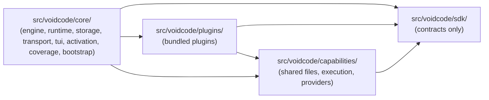

# VoidCode Developer & Agent Guide

This document is the primary reference for autonomous agents and developers modifying the VoidCode codebase. It defines architectural boundaries, coding conventions, subsystem navigation, and operational workflows.

## Architecture & Subsystem Boundaries

VoidCode is a small trusted core plus shared product capabilities, a Python plugin SDK and a bundled official plugin set:



- **SDK (`src/voidcode/sdk/`)**:
  The only contract surface shared by the core and every plugin: plugin registration (`plugin.py`), tools (`tools.py`), commands (`commands.py`), invocation context (`invocation.py`), provider contracts (`provider.py`), hook/observer and paged durable-fact contracts (`hooks.py`), declarative views (`views.py`), scoped services (`services.py`), configuration parsing (`config.py`), typed optional queries (`queries.py`, `workspace_queries.py`), plus the shared JSON/limit helpers (`json_values.py`, `codec.py`, `limits.py`).
- **Core (`src/voidcode/core/`)**:
  The product: `engine.py` runs governed turns over append-only events with durable native tool batches, approvals and confirmation gates; `bootstrap.py` owns configuration and the per-workspace state directory; `activation.py` admits configured plugin sources and switches revisions; `plugins.py` is the in-process plugin runtime that loads plugin packages and dispatches invocations by direct call; `services.py` binds scoped services to one invocation lease; `processes.py` owns child processes and supervised services; `storage/` owns the SQLite store and schema; `transport/` serves the HTTP/SSE API and the built web client; `tui/` is the inline-scrollback client; `coverage.py` projects tool results for the model and resolves resource paths.
- **Bundled plugins (`src/voidcode/plugins/`)**:
  The official plugins ship in the wheel. They extend the built-in product with tools, commands, providers, hooks, views, and session state using the same public SDK a third-party plugin gets. The core's reserved control surface (Layer Rule 2) is not a plugin.

### Layer Rules

1. **The SDK has no implementation dependencies.** `sdk/` may import the standard library, `pydantic`, and `jsonschema` only; never `core/` or `plugins/`. Enforced by `tests/unit/sdk/test_sdk_direction.py`.
2. **The core imports no concrete plugin.** The core knows plugin ids, roots, and configs, never a plugin module. Plugin-declared tools, commands, providers, and views arrive through admission (`core/activation.py`) and the in-process runtime (`core/plugins.py`). Separately, the core owns its own control surface: the reserved core commands (`run`, `resume`, `show`, `status`, `help`, `core.reload`) and the reserved `core_reload` tool are defined and dispatched in `engine.py` over the same typed command/tool contracts, and a plugin may never declare or shadow those names (`core/plugins.py`: `RESERVED_COMMAND_NAMES`, `RESERVED_COMMAND_PREFIXES`, `RESERVED_TOOL_NAMES`).
3. **Plugins import the SDK and shared capabilities** (plus their own third-party dependencies). Shared capabilities (`src/voidcode/capabilities/`) depend only on the SDK and their own dependencies, never on the core or concrete plugins. A plugin that needs core behavior asks for it through `PluginServices`; there is no private core entry for bundled plugins.

The core statically registers file tools and `shell_exec`, plus provider adapters, even when
no plugin is admitted. These defaults use the ordinary governed dispatch and leases, are owned
by `core`, and are not plugin sources. An admitted plugin may replace a default tool/provider
by name; duplicate names between two plugins still fail. Disabling a plugin removes its
registrations, not the core defaults. Use policy/visibility controls to restrict built-in tools.

Plugin collaboration uses shared SDK `QueryContract` objects: providers register with `bind`,
consumers call `ask`, and neither imports a concrete peer. Preserve the difference between
`QueryUnavailable`, a `None` resource answer, malformed data, and handler errors. Workflow
profiles use the current visible tool subset; never retry failed child creation with a wider
scope. See `docs/contracts/optional-queries.md`.

## Where to Look

| Task / Domain | Location | Key Entrypoint |
|---|---|---|
| Governed turns, approvals, budgets, continuations | `src/voidcode/core/` | `engine.py` (`Core`) |
| Product wiring: config, state directory, revision restore | `src/voidcode/core/` | `bootstrap.py` (`open_core`, `state_directory`) |
| Plugin admission, hot activation | `src/voidcode/core/` | `activation.py` (`admit_live`, `restore_admission`) |
| In-process plugin runtime, invocation leases, child processes | `src/voidcode/core/` | `plugins.py` (`PluginRuntime`), `services.py`, `processes.py` |
| Append-only session persistence | `src/voidcode/core/storage/` | `store.py` (`SqliteStore`), `schema.sql` |
| HTTP/SSE transport and served web bundle | `src/voidcode/core/transport/` | `http.py`, `server.py`, `static.py` |
| Inline TUI client | `src/voidcode/core/tui/` | `terminal_app.py`, `client.py`, `views.py` |
| CLI entry point and subcommands | `src/voidcode/core/` | `__main__.py` (`main`) |
| SDK contracts (the only shared surface) | `src/voidcode/sdk/` | `plugin.py`, `tools.py`, `commands.py`, `services.py` |
| Bundled plugins | `src/voidcode/plugins/<plugin_id>/` | `__init__.py` exporting `create_plugin` |
| Web client (core app) | `frontend/src/core/` | `CoreApp.tsx`, `views/` |

## Entry Points & Product Surfaces

One CLI serves every operation: `python -m voidcode.core [OPTIONS] [COMMAND]` (the `voidcode` console script is the same entry point once installed). The bare command opens the terminal client.

- **Agent runs**: `run "<prompt>" [--session-id] [--max-steps]`, `resume <session_id> [--approval-request-id --decision allow|deny] [--max-steps]`.
- **Session truth**: `create-session`, `sessions [--limit]`, `show <session_id> [--events]` (a rescue read that needs no configuration, host, or revision check).
- **Capability surface**: `catalog`, `invoke <session_id> <name> --arguments JSON --expected-revision <id>`, `confirm <session_id> <request_id> --decision allow|deny --expected-revision <id>`, `views <session_id>`, `drain <session_id> [--limit]`, `usage <session_id> [--since-sequence] [--until-sequence]`.
- **Clients**: bare `[--server URL --token TOKEN --session-id ID]` (spawns a supervisor child process by default and talks to it over HTTP exactly like `--server` mode, so a core replacement never kills the UI; `--session-id` attaches to an existing session, otherwise the latest session or a new one), `serve [--host] [--port] [--bearer-token] [--session-id] [--open]` (loopback only; supervises one core child with a stable endpoint and token, serves `/api` plus the built web bundle at `/`). The other operational subcommands (`run`, `resume`, `create-session`, `sessions`, `catalog`, `invoke`, `confirm`, `views`, `drain`, `usage`) execute inside the elected image (re-executing into it when the invoking installation is not it), while `show` opens no core and needs no configuration.
- **Root options**: `--workspace PATH` (default: the current directory), `--state-dir PATH`; bare-client-only `--server/--token/--session-id` are rejected with any subcommand.

In-session commands come from the core command catalog: the reserved core commands (`run`, `resume`, `show`, `status`, `help`, `core.reload`) plus every plugin-declared command. They reach every client the same way — `/<name>` in the TUI and web client, `voidcode invoke` from the CLI — and there is no client-side command table.

## Plugin Anatomy

A plugin is a Python package directory whose `__init__.py` exports `create_plugin(config) -> Plugin`. The returned `Plugin` is the single truth: tools, commands, providers, views, queries, context/observer callbacks, lifecycle hooks, pre/post-tool hooks, state schema, migration/deactivation transforms, `close`. There is no manifest, no pinning, and no trust flag — plugins are trusted code equal to the application.

- **Reserved config key**: the core injects the resolved providers map into every factory as `config["providers"]`. Strict plugin parsers accept and ignore it; plugins that register providers consume it. Never publish credentials from it into state, events, views, or errors.
- **Revisions**: the admitted generation is the *revision*: an opaque UUID names the recorded config/composition, with the private snapshot digest remaining for config integrity. A restart imports the current source with the recorded configuration. A changed SDK or a different image refuses to serve the older workspace revision; the explicit path is the controlled core upgrade (`voidcode upgrade run --candidate <install> --session-id <id>`: preflight, drain, adoption, election — see `docs/contracts/core-upgrade.md`), and a hot reload never crosses an SDK or image change.
- **Hot activation**: `core.reload` re-admits the live configuration and commits a new revision in-session. To remove a plugin, disable it via `core.reload` on the old core first so its real `prepare_deactivate` runs, then upgrade. Every state-owning bundled plugin declares one (see `docs/contracts/hot-activation.md`); profile listing (`/agents`, `/agents.show`) ships inside `delegation`, which also owns `task`/`task_batch`.

## Configuration & State

- **Configuration**: `voidcode.json` at the workspace root, and only that file. The core rejects a legacy `.voidcode.json` explicitly and performs no conversion. See [`docs/configuration.md`](./docs/configuration.md).
- **State**: `$XDG_STATE_HOME/voidcode/<workspace-sha256>/`, containing `voidcode.db`, `artifacts/` (tool-output artifacts), `private/` (the 0600 configuration snapshot carrying credentials), `kernel-images/`, and `supervisor/`. The state directory must live outside the workspace; `--state-dir` overrides it.
- **Persistence**: session history is an append-only SQLite event stream. There is no fork, undo, revert, checkout, or import: clients are commit-once ledgers over durable facts.
- **Credentials**: provider `api_key` values live only in the private snapshot; revisions and events carry digests, never secrets.

## Engineering Conventions & Taste

- **Validate at the Ingress Boundary**:
  Configuration, CLI arguments, command arguments, and HTTP bodies are validated once at entry (strict parsers that reject unknown fields). Internal code relies on typed dataclasses and Protocol contracts.
- **Fail Visibly**:
  Preserve `None` and distinct unknown states from known values. Missing required contract fields raise a clear error; a service that cannot answer says so instead of inventing a placeholder.
- **Immutable Append-Only Events**:
  Persisted events are historical facts. Session views, transcripts, usage, and plugin views are projections of that stream.
- **Recorded Configuration on Recovery**:
  A restart imports the current plugin source with the persisted revision's recorded configuration and private snapshot. Changed configuration is never admitted implicitly, and interrupted mutations are never replayed blindly.
- **Standard Library First**:
  Prefer simple, readable Python 3.14 standard library constructs before introducing abstractions or dependencies, and keep a single authoritative implementation path.

## Developer Commands

```bash
# Full gate: lint, typecheck, Python tests, frontend checks
mise run check

# Same hooks the commit gate runs
uv run pre-commit run --all-files

# Individual checks
mise run lint            # Ruff
mise run format          # Ruff formatter
mise run typecheck       # ty
mise run test            # Python test suite
mise run test:coverage   # Python tests with coverage summary
```

## Code Navigation (CodeGraph)

CodeGraph indexes Python and TypeScript symbols into `.codegraph/codegraph.db`:

```bash
# Initialize index (one-time)
codegraph init .

# Synchronize index after editing code
codegraph sync .

# Structural search across the codebase
codegraph query --path . 'Core'

# Inspect symbol definitions
codegraph node --path . --file src/voidcode/core/engine.py Core
```

## Detailed Documentation References

- [Architecture Overview](./docs/architecture.md)
- [Configuration Guide](./docs/configuration.md)
- [Coding Standards](./docs/coding-standards.md)
- [Testing Policy](./docs/testing.md)
- [Core & Plugin Contracts](./docs/contracts/README.md)

## Public Facts

Plugins consume typed SDK facts through observers or `PluginServices.read_facts()`, rather than classifying tool names or parsing private `kernel.*` payloads. Tools declare business semantics separately from governance effects and report actual resource observations on their results. Historical semantics come from the committed invocation, never the current catalog. See [public facts](./docs/contracts/facts.md) for paging, unknown historical metadata, and metric definitions.
