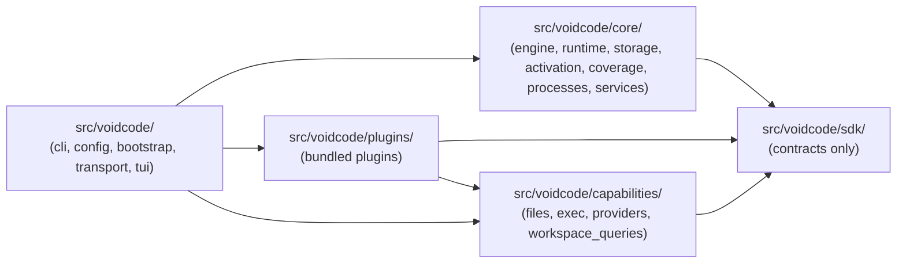

# VoidCode Developer & Agent Guide

This document is the primary reference for autonomous agents and developers modifying the VoidCode codebase. It defines architectural boundaries, coding conventions, subsystem navigation, and operational workflows.

## Architecture & Subsystem Boundaries

VoidCode is a minimal trusted core plus an outer product layer (CLI, configuration, bootstrap, transport, TUI), shared product capabilities, a Python plugin SDK, and bundled official plugins:



- **SDK (`src/voidcode/sdk/`)**:
  The contract surface shared by core and plugins: plugin registration (`plugin.py`), tools (`tools.py`), commands (`commands.py`), invocation context (`invocation.py`), provider contracts (`provider.py`), hook/observer contracts (`hooks.py`), declarative views (`views.py`), scoped services (`services.py`, including the optional-query transport and its `QueryUnavailable`/`QueryContractError` errors), history page bounds (`history.py`), plus JSON and limit helpers (`json_values.py`, `codec.py`, `limits.py`). No configuration schema, no workspace query contracts, no state migration hook.
- **Core (`src/voidcode/core/`)**:
  The minimal engine: `engine.py` runs governed turns over append-only SQLite events with native tool batches, approvals, and confirmation gates; `activation.py` defines neutral execution configurations and state copies; `plugins.py` is the in-process plugin runtime that loads plugins and dispatches invocations synchronously; `services.py` binds scoped services to invocation leases; `processes.py` owns child processes and background jobs; `storage/` owns the append-only SQLite store and v6 schema; `coverage.py` projects tool results for the model and resolves resource paths; `history_renderer.py` renders the readable event projection the history services share. Core has zero product configuration or provider credential concepts and imports no outer adapters, no capabilities, and no concrete plugin.
- **Outer product layer (`src/voidcode/`)**:
  Product wiring: `cli.py` (CLI entry point for `voidcode` and `python -m voidcode`), `config.py` (product `voidcode.json` schema and flat provider resolution), `bootstrap.py` (admission assembly, `open_core`, generation adoption, and bundled sources), `transport/` (WebSocket RPC server and web client bundle delivery), and `tui/` (terminal interface).
- **Bundled plugins (`src/voidcode/plugins/`)**:
  The official plugins ship with the product. All tools (files, exec, providers, etc.) exist only through admitted plugins: there are no fallback builtins in the core.
### Layer Rules

1. **The SDK has no implementation dependencies.** `sdk/` may import the standard library, `pydantic`, and `jsonschema` only; never `core/` or `plugins/`. Enforced by `tests/unit/sdk/test_sdk_direction.py`.
2. **The core imports no concrete plugin, no capability module, and no outer adapter.** The core knows plugin ids, roots, and configs, never a plugin module. Plugin-declared tools, commands, providers, and views arrive through admission (`core/activation.py`) and the in-process runtime (`core/plugins.py`). Separately, the core owns its own control surface: the reserved core commands (`run`, `resume`, `show`, `status`, `help`, `core.reload`) and the reserved `core_reload` tool are defined and dispatched in `engine.py` over the same typed command/tool contracts, and a plugin may never declare or shadow those names (`core/plugins.py`: `RESERVED_COMMAND_NAMES`, `RESERVED_COMMAND_PREFIXES`, `RESERVED_TOOL_NAMES`).
3. **Plugins import the SDK and shared capabilities** (plus their own third-party dependencies). Shared capabilities (`src/voidcode/capabilities/`) depend only on the SDK and their own dependencies, never on the core or concrete plugins. A plugin that needs core behavior asks for it through `PluginServices`; there is no private core entry for bundled plugins.

The core has no built-in tools or fallback providers: files, execution, and model providers are ordinary plugins. A zero-plugin core manages sessions and SQLite persistence only, with no assumption of file, shell, or model access. Disabling a plugin removes its capabilities completely with no hidden fallback.
Plugin collaboration uses shared `bind` / `ask` query helpers: providers register with `bind`,
consumers call `ask`, and neither imports a concrete peer. Preserve the difference between
`QueryUnavailable`, a `None` resource answer, malformed data, and handler errors. Bounded transcript reads use the SDK history services (`read_session_history`, `read_child_history` → `HistoryPage`). Workflow
profiles use the current visible tool subset; never retry failed child creation with a wider
scope. See `docs/contracts/optional-queries.md`.

## Where to Look

| Task / Domain | Location | Key Entrypoint |
|---|---|---|
| Governed turns, approvals, budgets, continuations | `src/voidcode/core/` | `engine.py` (`Core`) |
| Core generation & activation state | `src/voidcode/core/` | `activation.py` (`Admission`, `ExecutionConfig`) |
| In-process plugin runtime, invocation leases | `src/voidcode/core/` | `plugins.py` (`PluginRuntime`), `services.py` |
| Append-only session persistence (schema v6) | `src/voidcode/core/storage/` | `store.py` (`SqliteStore`), `schema.sql` |
| Product config & voidcode.json parser | `src/voidcode/` | `config.py` (`Config`, `parse_config`) |
| Product wiring, admission, adoption | `src/voidcode/` | `bootstrap.py` (`open_core`, `adopt_generation`) |
| CLI entry point and subcommands | `src/voidcode/` | `cli.py` (`main`) |
| WebSocket RPC transport and web client bundle | `src/voidcode/transport/` | `http.py`, `server.py`, `static.py` |
| Inline TUI client | `src/voidcode/tui/` | `terminal_app.py`, `client.py` |
| SDK contracts (contracts only) | `src/voidcode/sdk/` | `plugin.py`, `tools.py`, `commands.py`, `services.py` |
| Capabilities (files, exec, providers, queries) | `src/voidcode/capabilities/` | `files/`, `exec/`, `providers/`, `workspace_queries.py` |
| Bundled plugins | `src/voidcode/plugins/<plugin_id>/` | `__init__.py` exporting `create_plugin` |
| Web client | `frontend/src/core/` | `CoreApp.tsx`, `views/` |

## Entry Points & Product Surfaces

One CLI serves every operation: `voidcode [OPTIONS] [COMMAND]` (or `python -m voidcode`). The bare command opens the terminal client against an in-process local server.

- **Agent runs**: `run "<prompt>" [--session-id] [--max-steps]`, `resume <session_id> [--approval-request-id --decision allow|deny] [--max-steps]`.
- **Session truth**: `create-session`, `sessions [--limit]`, `show <session_id> [--events]` (a rescue read directly from SQLite without starting a core).
- **Capability surface**: `catalog`, `invoke <session_id> <name> --arguments JSON --expected-revision <id>`, `confirm <session_id> <request_id> --decision allow|deny --expected-revision <id>`, `views <session_id>`, `drain <session_id> [--limit]`, `usage <session_id> [--since-sequence] [--until-sequence]`.
- **Clients**: bare `[--server URL --token TOKEN --session-id ID]`, `serve [--host] [--port] [--bearer-token] [--open]` (loopback only, binds dynamically on port 0 with IPv6 bracketed, serves WebSocket RPC API plus built web bundle at `/`).
- **Root options**: `--workspace PATH` (default: current directory), `--state-dir PATH`.

In-session commands come from the core command catalog: the reserved core commands (`run`, `resume`, `show`, `status`, `help`, `core.reload`) plus every plugin-declared command. They reach every client the same way — `/<name>` in the TUI and web client, `voidcode invoke` from the CLI — and there is no client-side command table.

## Plugin Anatomy

A plugin is a Python package directory whose `__init__.py` exports `create_plugin(config) -> Plugin`. The returned `Plugin` is the single truth: tools, commands, providers, views, queries, context/observer callbacks, lifecycle hooks, pre/post-tool hooks, state schema, deactivation transform, `close`. There is no manifest, no pinning, and no trust flag — plugins are trusted code equal to the application. There is no `migrate_state` hook: a state schema increase the stored state does not match is refused visibly.

- **Reserved config key**: the product layer injects the resolved providers map into every factory as `config["providers"]`. Strict plugin parsers accept and ignore it; plugins that register providers consume it. Never publish credentials from it into state, events, views, or errors.
- **Revisions**: the admitted generation is the *revision*: an opaque UUID names the recorded config/composition, with the private snapshot digest remaining for config integrity. A restart imports the current source with the recorded configuration. Changed configuration is never admitted implicitly; `core.reload` re-admits the live file as a new revision in-session, and a hot reload never crosses an SDK or image change.
- **Hot activation**: `core.reload` re-admits the live configuration and commits a new revision in-session. To remove a plugin, disable it via `core.reload` on the old core first so its real `prepare_deactivate` runs. Every state-owning bundled plugin declares one (see `docs/contracts/hot-activation.md`); profile listing (`/agents`, `/agents.show`) ships inside `delegation`, which also owns `task`/`task_batch`.

## Configuration & State

- **Configuration**: `voidcode.json` at the workspace root, and only that file. Only `voidcode.json` is ever read; any other filename is ignored, not detected or converted. See [`docs/configuration.md`](./docs/configuration.md).
- **State**: `$XDG_STATE_HOME/voidcode/<workspace-sha256>/`, containing `voidcode.db` (schema v6; any other version is refused read-only), `artifacts/` (tool-output artifacts), and `private/` (the 0600 configuration snapshot carrying credentials). The state directory must live outside the workspace; `--state-dir` overrides it.
- **Persistence**: session history is an append-only SQLite event stream. There is no fork, undo, revert, checkout, or import: clients are commit-once ledgers over durable facts.
- **Credentials**: provider `api_key` values live only in the private snapshot; revisions and events carry digests, never secrets.

## Engineering Conventions & Taste

- **Validate at the Ingress Boundary**:
  Configuration, CLI arguments, command arguments, and HTTP bodies are validated once at entry (strict parsers that reject unknown fields). Internal code relies on typed dataclasses and Protocol contracts.
- **Fail Visibly**:
  Preserve `None` and distinct unknown states from known values. Missing required contract fields raise a clear error; a service that cannot answer says so instead of inventing a placeholder.
- **Immutable Append-Only Events**:
  Persisted events are historical facts. Session views, transcripts, usage, and plugin views are projections of that stream.
- **Recorded Configuration on Recovery**:
  A restart imports the current plugin source with the persisted revision's recorded configuration and private snapshot. Changed configuration is never admitted implicitly, and interrupted mutations are never replayed blindly.
- **Standard Library First**:
  Prefer simple, readable Python 3.14 standard library constructs before introducing abstractions or dependencies, and keep a single authoritative implementation path.

## Developer Commands

```bash
# Full gate: lint, typecheck, Python tests, frontend checks
mise run check

# Same hooks the commit gate runs
uv run pre-commit run --all-files

# Individual checks
mise run lint            # Ruff
mise run format          # Ruff formatter
mise run typecheck        # ty
mise run test             # Python test suite
mise run test:coverage    # Python tests with coverage summary
```

## Code Navigation (CodeGraph)

CodeGraph indexes Python and TypeScript symbols into `.codegraph/codegraph.db`:

```bash
# Initialize index (one-time)
codegraph init .

# Synchronize index after editing code
codegraph sync .

# Structural search across the codebase
codegraph query --path . 'Core'

# Inspect symbol definitions
codegraph node --path . --file src/voidcode/core/engine.py Core
```

## Detailed Documentation References

- [Architecture Overview](./docs/architecture.md)
- [Configuration Guide](./docs/configuration.md)
- [Coding Standards](./docs/coding-standards.md)
- [Testing Policy](./docs/testing.md)
- [Core/SDK Contracts](./docs/contracts/README.md)

## Public Facts

Plugins consume typed SDK facts through observers or `PluginServices.read_facts()`, rather than classifying tool names or parsing private `core.*` payloads. Tools declare governance effects; results and the runtime contribute observations (reads, changes, paths). Historical facts use committed metadata, never the current catalog. See [public facts](./docs/contracts/facts.md) for paging, byte-observation semantics, and unknown historical metadata.
