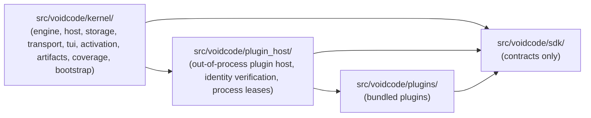

# VoidCode Developer & Agent Guide

This document is the primary reference for autonomous agents and developers modifying the VoidCode codebase. It defines architectural boundaries, coding conventions, subsystem navigation, and operational workflows.

## Architecture & Subsystem Boundaries

VoidCode is a small trusted kernel plus a Python plugin SDK, a bundled official plugin set, and a replaceable out-of-process plugin host:



- **SDK (`src/voidcode/sdk/`)**:
  The only contract surface shared by the kernel, the plugin host, and every plugin: plugin registration (`plugin.py`), manifests (`manifest.py`), tools (`tools.py`), commands (`commands.py`), invocation context (`invocation.py`), provider contracts (`provider.py`), hook/observer contracts (`hooks.py`), declarative views (`views.py`), scoped services (`services.py`), configuration parsing (`config.py`), plus the shared JSON/limit helpers (`json_values.py`, `codec.py`, `limits.py`).
- **Kernel (`src/voidcode/kernel/`)**:
  The product: `engine.py` runs governed turns over append-only events with durable native tool batches, approvals and confirmation gates; `bootstrap.py` owns configuration, plugin trust and the per-workspace state directory; `activation.py` pins trusted plugin bytes into content-addressed artifacts and switches capability revisions; `host.py` manages plugin host processes and invocation lifecycles; `storage/` owns the SQLite store and schema; `transport/` serves the HTTP/SSE API and the built web client; `tui/` is the inline-scrollback client; `artifacts.py` owns kernel artifacts; `coverage.py` tracks what a session's model has genuinely been shown.
- **Plugin host (`src/voidcode/plugin_host/`)**:
  Runs plugin code outside the kernel process: `server.py` is the stdio host that verifies admitted identities and serves invocations, `processes.py` owns lease-scoped child processes and supervised background processes.
- **Bundled plugins (`src/voidcode/plugins/`)**:
  The official plugins ship in the wheel and are trusted by construction. They own all product mechanisms — tools, commands, providers, hooks, views, and session state — using the same public SDK a third-party plugin gets. The kernel's reserved control surface (Layer Rule 2) is not a plugin.

### Layer Rules

1. **The SDK has no implementation dependencies.** `sdk/` may import the standard library, `pydantic`, and `jsonschema` only; never `kernel/`, `plugin_host/`, or `plugins/`. Enforced by `tests/unit/sdk/test_sdk_direction.py`.
2. **The kernel imports no concrete plugin.** The kernel knows plugin ids, manifests, and artifacts, never a plugin module. Plugin-declared tools, commands, providers, and views arrive through admission (`kernel/activation.py`) and the plugin host. Separately, the kernel owns its own control surface: the reserved core commands (`run`, `resume`, `show`, `status`, `help`, `kernel.reload`) and the reserved `kernel_reload` tool are defined and dispatched in `engine.py` over the same typed command/tool contracts, and a plugin may never declare or shadow those names (`plugin_host/server.py`: `RESERVED_COMMAND_NAMES`, `RESERVED_COMMAND_PREFIXES`, `RESERVED_TOOL_NAMES`).
3. **Plugins import only the SDK** (plus their own third-party dependencies). A plugin that needs kernel behavior asks for it through `PluginServices`; there is no private kernel entry for bundled plugins.

## Where to Look

| Task / Domain | Location | Key Entrypoint |
|---|---|---|
| Governed turns, approvals, budgets, continuations | `src/voidcode/kernel/` | `engine.py` (`Kernel`) |
| Product wiring: config, trust, state directory, revision restore | `src/voidcode/kernel/` | `bootstrap.py` (`open_kernel`, `state_directory`) |
| Plugin admission, pinned artifacts, hot activation | `src/voidcode/kernel/` | `activation.py` (`admit_live`, `restore_admission`) |
| Plugin host processes and invocation lifecycles (kernel side) | `src/voidcode/kernel/` | `host.py` (`HostClient`) |
| Out-of-process plugin host, identity verification, process leases | `src/voidcode/plugin_host/` | `server.py`, `processes.py` |
| Append-only session persistence | `src/voidcode/kernel/storage/` | `store.py` (`SqliteStore`), `schema.sql` |
| HTTP/SSE transport and served web bundle | `src/voidcode/kernel/transport/` | `http.py`, `server.py`, `static.py` |
| Inline TUI client | `src/voidcode/kernel/tui/` | `terminal_app.py`, `client.py`, `views.py` |
| CLI entry point and subcommands | `src/voidcode/kernel/` | `__main__.py` (`main`) |
| SDK contracts (the only shared surface) | `src/voidcode/sdk/` | `plugin.py`, `manifest.py`, `tools.py`, `commands.py`, `services.py` |
| Bundled plugins | `src/voidcode/plugins/<plugin_id>/` | `voidcode-plugin.json` + its entry module |
| Web client (kernel app) | `frontend/src/kernel/` | `KernelApp.tsx`, `views/` |
| Plugin identity gate | `scripts/` | `generate_plugin_identities.py` |

## Entry Points & Product Surfaces

One CLI serves every operation: `python -m voidcode.kernel [OPTIONS] [COMMAND]` (the `voidcode` console script is the same entry point once installed). The bare command opens the terminal client.

- **Agent runs**: `run "<prompt>" [--session-id] [--max-steps]`, `resume <session_id> [--approval-request-id --decision allow|deny] [--max-steps]`.
- **Session truth**: `create-session`, `sessions [--limit]`, `show <session_id> [--events]` (a rescue read that needs no configuration, host, or revision check).
- **Capability surface**: `catalog`, `invoke <session_id> <name> --arguments JSON --expected-revision <id>`, `confirm <session_id> <request_id> --decision allow|deny --expected-revision <id>`, `views <session_id>`, `drain <session_id> [--limit]`, `usage <session_id> [--since-sequence] [--until-sequence]`.
- **Clients**: bare `[--server URL --token TOKEN --session-id ID]` (spawns a supervisor child process by default and talks to it over HTTP exactly like `--server` mode, so a kernel replacement never kills the UI; `--session-id` attaches to an existing session, otherwise the latest session or a new one), `serve [--host] [--port] [--bearer-token] [--session-id] [--open]` (loopback only; supervises one kernel child with a stable endpoint and token, serves `/api` plus the built web bundle at `/`). The other operational subcommands (`run`, `resume`, `create-session`, `sessions`, `catalog`, `invoke`, `confirm`, `views`, `drain`, `usage`) execute inside the elected image (re-executing into it when the invoking installation is not it), while `show` opens no kernel at all: it is the rescue read that goes straight to the SQLite file with no configuration, host, or revision check.
- **Root options**: `--workspace PATH` (default: the current directory), `--state-dir PATH`, `--trust-plugin PLUGIN_ID` (repeatable); bare-client-only `--server/--token/--session-id` are rejected with any subcommand.

In-session commands come from the kernel command catalog: the reserved core commands (`run`, `resume`, `show`, `status`, `help`, `kernel.reload`) plus every plugin-declared command. They reach every client the same way — `/<name>` in the TUI and web client, `voidcode invoke` from the CLI — and there is no client-side command table.

## Plugin Anatomy & Identity Workflow

A plugin is a directory with a `voidcode-plugin.json` manifest and the exact source files the manifest pins:

- **Manifest keys** (`src/voidcode/sdk/manifest.py`): `schema_version`, `sdk_protocol`, `plugin_id` (`[a-z][a-z0-9_-]*`), `version`, `entrypoint` (`module:callable`), `files` (path + sha256 identities), `capabilities`, `config_schema`, `state_schema` / `state_schema_version`, `tools`, `commands`, `providers`, `hooks`, and `depends` (plugin dependency closure).
- **Admission never imports the candidate.** `admit_plugin` (`kernel/activation.py`) validates the manifest, verifies every declared file hash, refuses undeclared Python sources, checks requested capabilities against the granted set (`workspace.read`, `workspace.write`, `network`), validates the plugin configuration against its `config_schema`, and copies the pinned bytes into `artifacts/<identity>` inside the state directory. The identity is the manifest hash, so an edited plugin source is a *new* identity, never an in-place mutation of an admitted one.
- **Identity regeneration**: after editing any bundled plugin source or manifest, run `mise run plugins:identities:generate`; `mise run plugins:identities:check` (also a pre-commit hook) refuses drift. Never hand-edit the `files` array.
- **Revisions**: the admitted generation is the capability *revision*. The SDK source hash and the elected image digest are pinned into the revision, so a changed SDK or a different image refuses to serve the older workspace revision; the explicit path is the controlled kernel upgrade (`voidcode upgrade run --candidate <install> --session-id <id>`: preflight, drain, adoption, election — see `docs/contracts/kernel-upgrade.md`), and a hot reload never crosses an SDK or image change.
- **Hot activation**: `kernel.reload` re-admits the live configuration and commits a new revision in-session; it only trusts source paths already authorized in the current generation. New external trust is a startup decision (`--trust-plugin`), never something a running session can grant itself.

## Configuration & State

- **Configuration**: `voidcode.json` at the workspace root, and only that file. The kernel rejects a legacy `.voidcode.json` explicitly and performs no conversion. See [`docs/configuration.md`](./docs/configuration.md).
- **State**: `$XDG_STATE_HOME/voidcode/kernel-v1/<workspace-sha256>/`, containing `kernel-v1.sqlite3`, `artifacts/` (pinned plugin sources), and `private/` (the 0600 configuration snapshot carrying credentials). The state directory must live outside the workspace; `--state-dir` overrides it.
- **Persistence**: session history is an append-only SQLite event stream. There is no fork, undo, revert, checkout, or import: clients are commit-once ledgers over durable facts.
- **Credentials**: provider `api_key` values live only in the private snapshot; revisions and events carry digests, never secrets.

## Engineering Conventions & Taste

- **Validate at the Ingress Boundary**:
  Configuration, manifests, CLI arguments, command arguments, and HTTP bodies are validated once at entry (strict parsers that reject unknown fields). Internal code relies on typed dataclasses and Protocol contracts.
- **Fail Visibly**:
  Preserve `None` and distinct unknown states from known values. Missing required contract fields raise a clear error; a service that cannot answer says so instead of inventing a placeholder.
- **Immutable Append-Only Events**:
  Persisted events are historical facts. Session views, transcripts, usage, and plugin views are projections of that stream.
- **Pinned Identity on Recovery**:
  A restart restores the persisted revision, its pinned plugin artifacts, and its private configuration snapshot. Changed workspace source or configuration is never admitted implicitly, and interrupted mutations are never replayed blindly.
- **Standard Library First**:
  Prefer simple, readable Python 3.14 standard library constructs before introducing abstractions or dependencies, and keep a single authoritative implementation path.

## Developer Commands

```bash
# Full gate: lint, typecheck, plugin identities, Python tests, frontend checks
mise run check

# Same hooks the commit gate runs
uv run pre-commit run --all-files

# Individual checks
mise run lint            # Ruff
mise run format          # Ruff formatter
mise run typecheck       # ty
mise run test            # Python test suite
mise run test:coverage   # Python tests with coverage summary

# Bundled plugin identities (run after editing plugin sources)
mise run plugins:identities:generate
mise run plugins:identities:check
```

## Code Navigation (CodeGraph)

CodeGraph indexes Python and TypeScript symbols into `.codegraph/codegraph.db`:

```bash
# Initialize index (one-time)
codegraph init .

# Synchronize index after editing code
codegraph sync .

# Structural search across the codebase
codegraph query --path . 'Kernel'

# Inspect symbol definitions
codegraph node --path . --file src/voidcode/kernel/engine.py Kernel
```

## Detailed Documentation References

- [Architecture Overview](./docs/architecture.md)
- [Configuration Guide](./docs/configuration.md)
- [Coding Standards](./docs/coding-standards.md)
- [Testing Policy](./docs/testing.md)
- [Kernel & Plugin Contracts](./docs/contracts/README.md)
