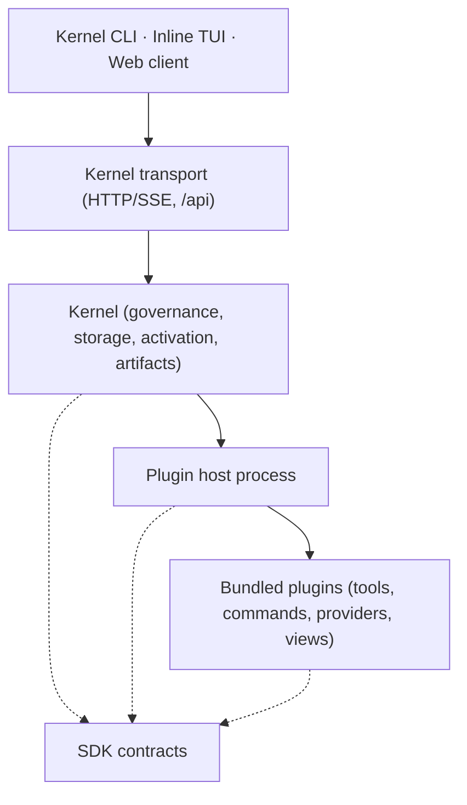

<p align="center">
  <a href="./LICENSE"></a>
  
  
</p>

# VoidCode

VoidCode is an open-source, local-first coding agent built as a small trusted kernel with a Python plugin SDK and a bundled official plugin set. It lets a model inspect workspaces, edit files, run commands, search the web, coordinate delegated work, and manage long-running goals — under configurable approval policy, with every turn and tool call persisted locally in append-only SQLite.

## Key Features

- **Local-first**: sessions, events, and checkpoints live in a per-workspace SQLite database under your XDG state directory. Sessions never leave the machine; network access happens only through the provider calls and network-capable tools (for example `web_fetch` and `web_search`) that you configure.
- **Plugin architecture**: every product mechanism — tools, commands, providers, hooks, views, and session state — is a plugin using the same public SDK a third-party plugin gets. The kernel imports no concrete plugin.
- **Pinned, reviewable plugins**: an admitted plugin is a content-addressed copy verified by manifest hash. Editing plugin source produces a new identity; it never mutates an admitted generation in place.
- **Append-only durability**: one immutable event stream per session. Views, transcripts, usage, and UI are projections; clients commit each fact exactly once and never rewind.
- **Three client surfaces, one contract**: the kernel CLI, an inline terminal UI, and a React web client all drive the same command catalog, declarative views, and SSE event stream.
- **Agent-facing delegation**: the primary agent delegates focused work through the `task`/`task_batch` tools; there is no separate human task console.

## Quickstart

### Prerequisites

Python 3.14 with [`uv`](https://docs.astral.sh/uv/), and [Bun](https://bun.sh/) if you want the web client:

```bash
mise install
uv sync --extra dev --extra syntax
mise run frontend:install   # web client only
```

### Configure a workspace

The kernel reads exactly one file, `voidcode.json`, from the workspace root. Write it yourself — there is no configuration CLI:

```json
{
  "schema_version": 1,
  "model": { "model": "openai/gpt-4o-mini" },
  "policy": { "approval_mode": "ask" },
  "providers": {
    "openai": { "api_key": "sk-...", "base_url": "https://api.openai.com/v1" }
  }
}
```

`api_key` may be omitted when the matching `<PROVIDER>_API_KEY` environment variable is set (here `OPENAI_API_KEY`). See the [Configuration Guide](./docs/configuration.md) for every field, plugin configuration, and trust rules.

### Run

```bash
# One agent turn; prints the result as JSON
voidcode run "Summarize this repository"

# Interactive TUI with inline scrollback (embedded kernel)
voidcode tui

# HTTP/SSE server plus the built web client at http://127.0.0.1:8000/
voidcode serve --port 8000
```

In a source checkout without the console script installed, use `uv run python -m voidcode.kernel` with the same subcommands. Every command accepts `--workspace PATH` (default: current directory), `--state-dir PATH`, and `--trust-plugin PLUGIN_ID`.

## Command Reference

### Kernel subcommands

| Command | Purpose |
|---|---|
| `voidcode run "<prompt>"` | Execute an agent turn in a new or existing session (`--session-id`, `--max-steps`). |
| `voidcode resume <session_id>` | Continue a session, optionally resolving an approval (`--approval-request-id`, `--decision allow\|deny`). |
| `voidcode create-session` | Create an empty session (`--session-id` to choose the id). |
| `voidcode sessions` | List this workspace's sessions (`--limit`). |
| `voidcode show <session_id>` | Inspect durable state; `--events` adds the raw event history. Works even when configuration is broken. |
| `voidcode catalog` | Print the admitted command catalog and its revision. |
| `voidcode invoke <session_id> <name>` | Invoke an admitted command (`--arguments JSON`, `--expected-revision`). |
| `voidcode confirm <session_id> <request_id>` | Resolve a plugin confirmation (`--decision allow\|deny`, `--expected-revision`). |
| `voidcode views <session_id>` | Render the current plugin views. |
| `voidcode drain <session_id>` | Execute pending durable continuations. |
| `voidcode usage <session_id>` | Report session token usage. |
| `voidcode tui` | Start the inline TUI (embedded kernel, or `--server`/`--token` for a remote one). |
| `voidcode serve` | Start the HTTP/SSE server and serve the web client (`--open` launches a browser). |

### In-session commands

Every client dispatches commands from the admitted catalog — the kernel's reserved commands (`/run`, `/resume`, `/show`, `/status`, `/help`, `/kernel.reload`) plus the plugin-declared commands below. Use `/name` in the TUI or web composer, or `voidcode invoke` from the CLI:

| Plugin | Commands |
|---|---|
| `session_info` | `/session_status`, `/context`, `/usage`, `/export`, `/copy` |
| `plan` | `/plan`, `/plan.off`, `/plan.status` |
| `todo` | `/todo`, `/todo.clear` |
| `goal` | `/goal`, `/goal.set`, `/goal.edit`, `/goal.pause`, `/goal.resume`, `/goal.clear`, `/goal.load_objective` |
| `skills` | `/skills` |
| `agents` | `/agents`, `/agents.show` |
| `review` | `/review` |
| `btw` | `/btw` |
| `cron` | `/loop` |
| `compaction` | `/compact` |
| `effectiveness` | `/effectiveness` |
| `lsp` | `/lsp` |
| `mcp` | `/mcp` |
| `user_shell` | `/shell` |

The TUI also has client-local controls that are not admitted commands: `/tui help`, `/tui sessions`, `/tui session <id>`, `/tui new`, `/tui views`, `/tui cancel`, `/tui quit`.

## Architecture



For an in-depth explanation, see the [Architecture Overview](./docs/architecture.md).

## Configuration & State

- **Configuration**: `voidcode.json` only. A legacy `.voidcode.json` is rejected explicitly and never converted.
- **State**: `$XDG_STATE_HOME/voidcode/kernel-v1/<workspace-sha256>/kernel-v1.sqlite3`, next to `artifacts/` (pinned plugins) and `private/` (the 0600 configuration snapshot). `--state-dir` overrides it; it must be outside the workspace.
- **No migration**: legacy session databases and configuration from earlier architectures are neither imported nor auto-deleted.

## Development & Testing

```bash
mise run check            # lint, typecheck, plugin identities, Python tests, frontend checks
uv run pre-commit run --all-files   # the same hooks the commit gate runs

mise run test             # Python suite
mise run frontend:test    # Vitest component tests
```

## Documentation

- [Architecture Overview](./docs/architecture.md): kernel, plugin host, SDK, and the bundled plugin set.
- [Configuration Guide](./docs/configuration.md): `voidcode.json` fields, trust rules, and state directory.
- [Coding Standards](./docs/coding-standards.md): conventions and commit formats.
- [Testing Policy](./docs/testing.md): test tiers, loopback providers, and offline guards.
- [Kernel & Plugin Contracts](./docs/contracts/README.md): durability, activation, goal, and client transport contracts.
- [Contributing](./CONTRIBUTING.md): development environment and pull request workflow.

## License

VoidCode is released under the [MIT License](./LICENSE).
