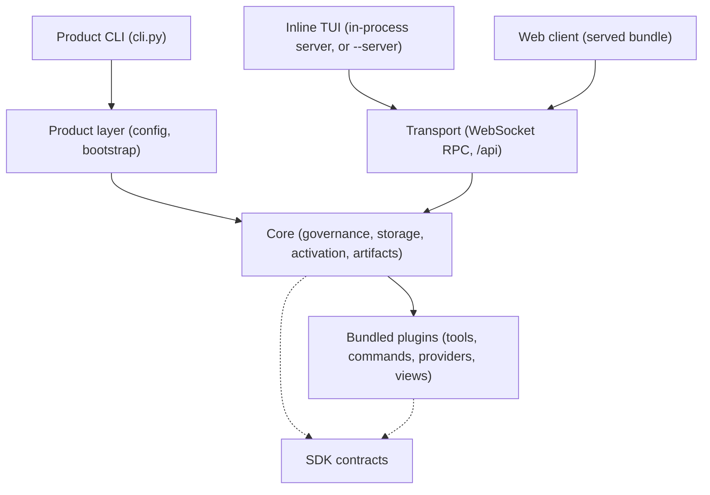

<p align="center">
  <a href="./LICENSE"></a>
  
  
</p>

# VoidCode

VoidCode is an open-source, local-first coding agent built as a small trusted core with a Python plugin SDK and a bundled official plugin set. It lets a model inspect workspaces, edit files, run commands, search the web, coordinate delegated work, and manage long-running goals — under configurable approval policy, with every turn and tool call persisted locally in append-only SQLite.

## Key Features

- **Local-first**: sessions, events, and checkpoints are stored in per-workspace SQLite under your XDG state directory. Configured model providers receive conversation context (prompts, tool results, and attachments); trusted plugins and tools may make network requests.
- **Plugin architecture**: every product mechanism — tools, commands, providers, hooks, views, and session state — is a plugin using the same public SDK a third-party plugin gets, and the core imports no concrete plugin. The core keeps only its own reserved control surface (`run`, `resume`, `show`, `status`, `help`, `core.reload`, and the `core_reload` tool), which a plugin can neither declare nor shadow.
- **Trusted plugins, no ceremony**: a plugin is a Python package whose `create_plugin` returns its registration — tools, commands, hooks, views, and state schema in one place. Plugins are trusted code equal to the application; revisions identify configuration and composition, never code bytes.
- **Append-only durability**: one immutable event stream per session. Views, transcripts, usage, and UI are projections; clients commit each fact exactly once and never rewind.
- **Three client surfaces, one contract**: the product CLI executes commands directly, and the inline terminal UI and React web client speak the same WebSocket RPC contract — one command catalog, one set of declarative views, one event stream.
- **Agent-facing delegation**: the primary agent delegates focused work through the `task`/`task_batch` tools; there is no separate human task console.
- **Explicit execution budgets**: fresh runs have no implicit 32-turn lifetime. Optional provider-turn caps and operator-granted root-action budgets are separate; finite root authorization is shared by descendants and survives restart without refilling.
- **Immutable result recovery**: selected tool text is projected once; complete machine results and captured resources remain byte-page readable through local or authenticated RPC clients. Viewer/image-terminal presentation is a separate surface; current limits and SDK gaps are tracked in the [TUI](./src/voidcode/tui/TODO.md) and [SDK](./src/voidcode/sdk/TODO.md) TODOs.

## Quickstart

### Prerequisites

Python 3.14 with [`uv`](https://docs.astral.sh/uv/), and [Bun](https://bun.sh/) if you want the web client:

```bash
mise install
uv sync --extra dev --extra syntax
mise run frontend:install   # web client only
```

### Configure a workspace

The product reads exactly one file, `voidcode.json`, from the workspace root. Write it yourself — there is no configuration CLI:

```json
{
  "schema_version": 1,
  "model": { "model": "openai/gpt-4o-mini" },
  "policy": { "approval_mode": "ask" },
  "providers": {
    "openai": { "base_url": "https://api.openai.com/v1" }
  }
}
```

Export the API key before starting VoidCode:

```bash
export OPENAI_API_KEY="sk-..."
```

No `.env` file is required. See [API Environment Variables](./docs/configuration.md#api-environment-variables) for credential names and search API keys, and the [Configuration Guide](./docs/configuration.md) for every field and plugin configuration.

### Run

```bash
# One agent turn; prints the result as JSON
voidcode run "Summarize this repository"

# Interactive TUI with inline scrollback (in-process local server)
voidcode

# WebSocket RPC server plus the built web client at http://127.0.0.1:8000/
voidcode serve --port 8000

# Every command documents itself
voidcode --help
voidcode run --help
```

In a source checkout without the console script installed, use `uv run python -m voidcode` with the same subcommands. Every command accepts `--workspace PATH` (default: current directory) and `--state-dir PATH`.

## Command Reference

### Core subcommands

| Command | Purpose |
|---|---|
| `voidcode run "<prompt>"` | Execute an agent turn in a new or existing session (`--session-id`, optional `--max-steps`, optional `--root-action-budget`). |
| `voidcode resume <session_id>` | Continue a session, optionally resolving approval (`--approval-request-id`, `--decision allow\|deny`), replacing its total `--max-steps` cap, or explicitly `--extend-root-actions N`. |
| `voidcode create-session` | Create an empty session (`--session-id` to choose the id). |
| `voidcode sessions` | List this workspace's sessions (`--limit`). |
| `voidcode show <session_id>` | Inspect durable state; `--events` adds the raw event history. Works even when configuration is broken. |
| `voidcode catalog` | Print the admitted command catalog and its revision. |
| `voidcode invoke <session_id> <name>` | Invoke an admitted command (`--arguments JSON`, `--expected-revision`). |
| `voidcode confirm <session_id> <request_id>` | Resolve a plugin confirmation (`--decision allow\|deny`, `--expected-revision`). |
| `voidcode views <session_id>` | Render the current plugin views. |
| `voidcode drain <session_id>` | Execute pending durable continuations. |
| `voidcode usage <session_id>` | Report session token usage. |
| `voidcode` | Start the inline TUI (in-process local server, or `--server`/`--token` for a remote one). |
| `voidcode serve` | Start the WebSocket RPC server and serve the web client (`--open` launches a browser). |

### In-session commands

Every client dispatches commands from the admitted catalog. TUI and web use space-separated paths such as `/core reload` and `/goal set`; dotted slash spellings are not aliases. RPC invocation and the catalog keep the dotted catalog ID, for example `core.reload`; CLI `invoke` accepts either the ID or the quoted public path (`voidcode invoke <session_id> "core reload" --expected-revision <revision_id>`):

| Plugin | Commands |
|---|---|
| `plan` | `/plan`, `/plan off`, `/plan status` |
| `todo` | `/todo`, `/todo add`, `/todo edit`, `/todo clear` |
| `goal` | `/goal`, `/goal set`, `/goal edit`, `/goal pause`, `/goal resume`, `/goal clear` |
| `skills` | `/skills`, `/skills show` |
| `providers` | `/model`, `/providers` |
| `subagents` | alt+a (subagent monitor) |
| `review` | `/review` |
| `btw` | `/btw` |
| `cron` | `/loop`, `/loop list`, `/loop delete` |
| `compaction` | `/compact` |
| `lsp` | `/lsp` |
| `mcp` | `/mcp` |
| `workflows` | `/workflow run`, `/workflow status`, `/workflow pause`, `/workflow resume`, `/workflow cancel` |
| `user_shell` | `!<command>` (command ID `shell`, not a slash command) |

The TUI also has client-local controls that are not admitted commands: `/tui help`, `/tui sessions`, `/tui session <id>`, `/tui new`, `/tui views`, `/tui cancel`, `/tui quit`.

The TUI opens on a quiet composer: no plugin views load until requested. Goal, provider, and model details stay behind their on-demand commands (`/goal`, `/providers`, `/model`), the local `/tui model` and `/tui thinking` controls switch embedded sessions, and `/tui views [name]` (for example `/tui views goal.details`) renders passive views inline while a form, choices, or confirmation opens as a framed dialog. The status line shows meaningful progress, errors, and gates — never session hashes — and explicit `/status`, `/show`, and `/tui sessions` keep diagnostics.

## Architecture



For an in-depth explanation, see the [Architecture Overview](./docs/architecture.md).

## Configuration & State

- **Configuration**: `voidcode.json` only. Only `voidcode.json` is ever read; any other filename is ignored, not detected or converted.
- **State**: `$XDG_STATE_HOME/voidcode/<workspace-sha256>/voidcode.db`, next to `private/` (the 0600 configuration snapshot) and `artifacts/` (content-addressed tool outputs). `--state-dir` overrides it; it must be outside the workspace.
- **No migration**: a database at any other schema version (including legacy v5) is refused read-only; legacy session databases from earlier architectures are neither imported nor auto-deleted.

## Development & Testing

```bash
mise run check            # lint, typecheck, Python tests, frontend checks
uv run pre-commit run --all-files   # the same hooks the commit gate runs

mise run test             # Python suite
mise run frontend:test    # Vitest component tests
```

## Documentation

- [Architecture Overview](./docs/architecture.md): core, product layer, SDK, and the bundled plugin set.
- [Configuration Guide](./docs/configuration.md): `voidcode.json` fields and state directory.
- [Coding Standards](./docs/coding-standards.md): conventions and commit formats.
- [Testing Policy](./docs/testing.md): test tiers, loopback providers, and offline guards.
- [Core/SDK Contracts](./docs/contracts/README.md): durability, activation, client transport, and the plugin entry-doc index.
- [Contributing](./CONTRIBUTING.md): development environment and pull request workflow.

## License

VoidCode is released under the [MIT License](./LICENSE).
