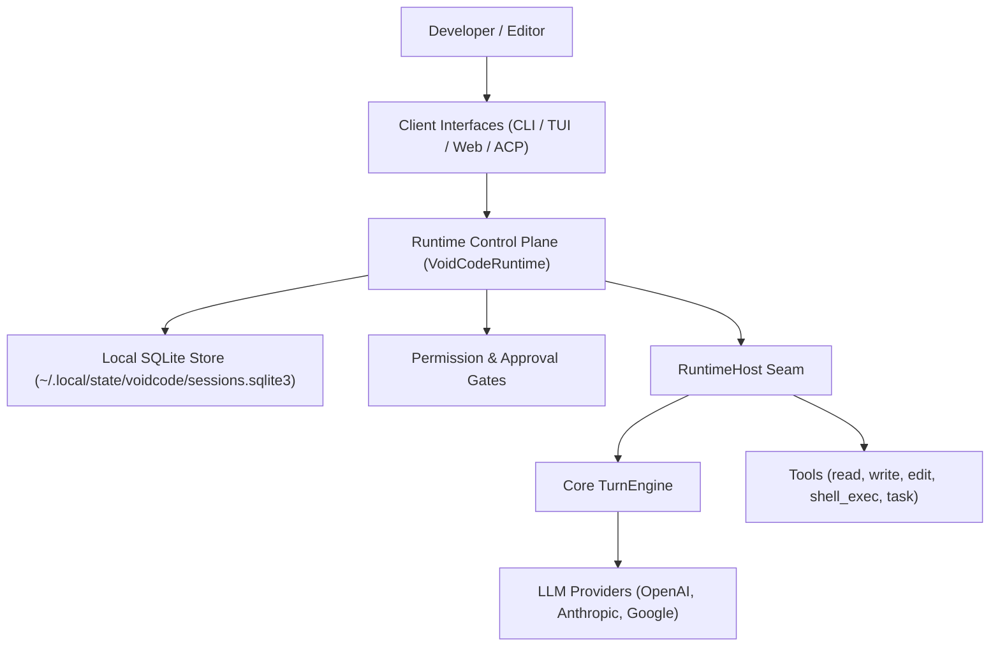

<p align="center">
  <a href="./LICENSE"></a>
  
  
</p>

# VoidCode

VoidCode is an open-source, local-first coding agent runtime inspired by OpenCode and Claude Code. It enables LLMs to inspect workspaces, edit files, execute shell commands, and coordinate delegated background tasks under configurable approval modes with local SQLite persistence.

## Key Features

- **Local-First Architecture**: Sessions, event logs, and checkpoints reside locally in SQLite (POSIX default: `~/.local/state/voidcode/sessions.sqlite3`, overridable via `XDG_STATE_HOME` or `VOIDCODE_DB_PATH`).
- **Configurable Approvals**: Supports `yolo` (default), `ask`, and `write` modes to govern tool execution permissions.
- **Durable Event-Sourced Sessions**: Every turn, tool invocation, and approval is persisted as an append-only event log. Sessions can be resumed, inspected, forked, or rolled back (`undo`, `revert`, `checkout`).
- **Multi-Interface Access**: Interact through a fast CLI, an interactive inline Terminal UI (with native scrollback), a modern React 19 web interface, or an ACP stdio JSON-RPC facade for editor integrations.
- **Hierarchical Task Delegation**: Primary sessions can delegate specialized background work to child agents (`explore`, `review`, `research`, `execute`, `plan`) with structured result reporting.

## Architecture

VoidCode separates runtime governance from turn progression:



For an in-depth explanation, see the [Architecture Overview](./docs/architecture.md).

## Quickstart

### Prerequisites

VoidCode targets Python 3.14 with `uv`, and Bun for the web frontend:

```bash
mise install
uv sync --extra dev --extra syntax
mise run frontend:install
```

### Initial Configuration

Initialize a starter `.voidcode.json` in your project workspace:

```bash
# Generate configuration for your preferred model
uv run voidcode config init --model openai/gpt-4o-mini --workspace .
```

Set your provider API key in your environment:

```bash
export OPENAI_API_KEY="your-api-key"
```

Verify your environment readiness:

```bash
uv run voidcode doctor --workspace .
```

### Running Tasks

Execute tasks through your preferred interface:

```bash
# Direct CLI execution
uv run voidcode run "Summarize src/voidcode/runtime/service.py" --workspace .

# Interactive Terminal UI (inline scrollback)
uv run voidcode tui --workspace .

# Local HTTP runtime & SSE server
uv run voidcode serve --workspace . --port 8765

# Web application launcher
mise run frontend:build
uv run voidcode web --workspace .
```

## CLI Reference

VoidCode provides a rich suite of commands for execution, session management, and task delegation:

| Command | Purpose |
|---|---|
| `voidcode run "PROMPT"` | Execute a task through the configured provider with real-time streaming. |
| `voidcode tui` | Launch the interactive terminal UI with inline scrollback. |
| `voidcode serve` | Start the local HTTP runtime transport and Server-Sent Events (SSE) server. |
| `voidcode web` | Build and open the React 19 web launcher. |
| `voidcode acp` | Run the stdio JSON-RPC facade for external editor integrations. |
| `voidcode sessions list` | List persisted sessions in the current workspace. |
| `voidcode sessions resume` | Replay or resume a persisted session response. |
| `voidcode sessions checkout` | Move a session's active branch to an earlier event entry. |
| `voidcode sessions fork` | Create an independent session fork from an existing session history. |
| `voidcode tasks list` | List delegated background tasks. |
| `voidcode tasks status` | Check lifecycle state of a delegated background task. |
| `voidcode tasks output` | Inspect output and structured results from a delegated task. |
| `voidcode config show` | View effective merged configuration. |
| `voidcode config init` | Generate a starter `.voidcode.json` configuration file. |
| `voidcode doctor` | Check toolchain, external commands, and provider readiness. |

Run `voidcode --help` or `voidcode <command> --help` for complete options and usage examples.

## Configuration

Workspace configuration is defined in `.voidcode.json`:

```json
{
  "$schema": "https://raw.githubusercontent.com/lei-jia-xing/voidcode/master/schema/voidcode.config.schema.json",
  "model": "openai/gpt-4o-mini",
  "approval_mode": "yolo"
}
```

VoidCode supports three approval modes:
- `yolo` (default): Executes tool actions autonomously without interactive confirmation.
- `ask`: Prompts for confirmation before state-modifying actions (file writes, edits, shell execution).
- `write`: Auto-approves file write and edit operations; prompts for shell command execution (`shell_exec`).

Execution timeouts (`tool_timeout_seconds`) are optional and unset by default.
See the [Configuration Guide](./docs/configuration.md) for full options and provider configurations.

## Development & Testing

Common tasks configured via `mise`:

```bash
# Linting & Formatting
mise run lint            # Check with Ruff
mise run format          # Format with Ruff
mise run typecheck       # Static typecheck with ty

# Tests
mise run test            # Run unit and integration tests
mise run test:coverage   # Run tests with coverage summary

# Full Verification
mise run check           # Run all Python, schema, and frontend checks
mise run pre-commit      # Run all pre-commit hooks
```

## Documentation

- [Architecture Overview](./docs/architecture.md): Subsystems, lifecycle, and event sourcing.
- [Configuration Guide](./docs/configuration.md): Configuration options, approval tiers, and custom providers.
- [Coding Standards](./docs/coding-standards.md): Code conventions, design principles, and commit formats.
- [Testing Policy](./docs/testing.md): Core coverage, offline test guards, and verification methods.
- [Runtime Contracts](./docs/contracts/README.md): Authoritative contracts for execution, delegation, and client transport.
- [Contributing](./CONTRIBUTING.md): Development environment setup and pull request workflow.

## License

VoidCode is released under the [MIT License](./LICENSE).
