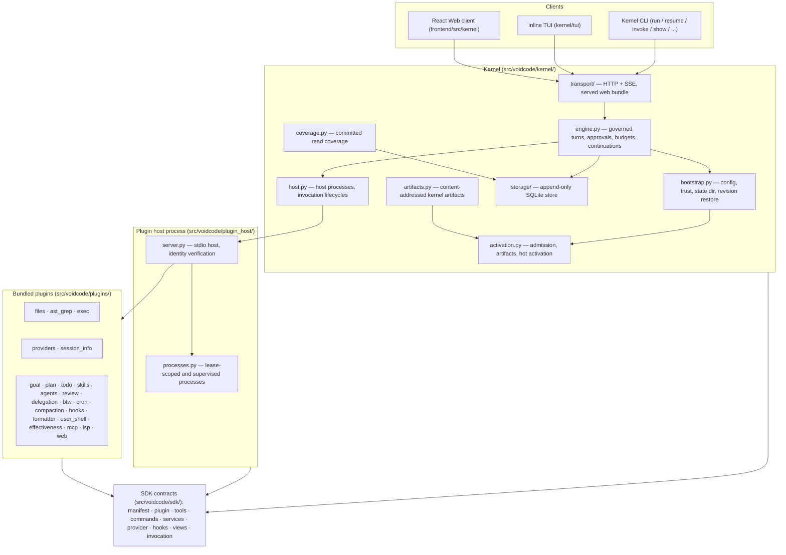

# Architecture Overview

VoidCode is a local-first coding agent built as a small trusted **kernel**, a versioned **plugin SDK**, an out-of-process **plugin host**, and a bundled plugin set that owns every product mechanism. Execution is durable and append-only, capabilities are pinned by identity, and clients talk to the kernel through one generic command/view/event contract rather than product-specific routes.

## Core Design Principles

1. **Trusted Kernel, Untrusted-Rooted Plugins**:
   The kernel (`src/voidcode/kernel/`) owns governance, persistence, streaming, and admission. Plugins own behavior — tools, commands, providers, hooks, views, and session state — and reach the kernel only through the SDK and the host protocol. Nothing in the kernel imports a concrete plugin.

2. **Contracts-Only SDK**:
   `src/voidcode/sdk/` is the single shared surface for the kernel, the plugin host, and every plugin, and it depends on nothing from the implementation layers (standard library, `pydantic`, and `jsonschema` only).

3. **Pinned Identity, Never Implicit Change**:
   An admitted plugin is copied into a content-addressed artifact directory named by its manifest hash, and every declared file's sha256 is verified. Editing plugin source produces a *new* identity; it never mutates the admitted one. The SDK source hash is pinned into the workspace revision, so a changed SDK refuses to restart against an old revision and requires a controlled upgrade.

4. **Append-Only Durability**:
   Session history is an immutable, monotonic event stream in SQLite. Views, transcripts, usage reports, and plugin-provided UI are projections of that stream. There is no fork, undo, revert, or checkout.

5. **Declarative Clients**:
   Clients (CLI, TUI, web) never hard-code product commands. They read the admitted command catalog and render bounded, typed plugin views, binding every action to the revision it was displayed under.

## Architecture Diagram

## Subsystem Details

### Kernel (`src/voidcode/kernel/`)

- **`engine.py` (`Kernel`)** — the authority for a run: it plans against admitted tools, classifies tool effects (`READ`, `WRITE`, `EXECUTE`, `SPAWN`, `SESSION`), applies policy (`policy.approval_mode` ∈ `ask` / `write` / `yolo` plus `policy.read_only`), gates externally mutating work, appends durable events and checkpoints, drives durable continuations, and settles cancellations and budget exhaustion. Reserved core commands such as `kernel.reload` are dispatched through the same typed command contract plugins use.
- **`bootstrap.py`** — product wiring: reads `voidcode.json`, resolves `--trust-plugin` into canonical source paths, computes the per-workspace state directory, adopts a first revision or restores the persisted one (refusing when the installed SDK no longer matches the active revision), and verifies the workspace is not owned by another kernel before writing.
- **`activation.py`** — admission and revision management: source resolution, the trust decision bound to canonical paths, artifact pinning, dependency closure ordering, private configuration snapshots, and state migration/deactivation plans for capability switches.
- **`host.py` (`HostClient`)** — starts and manages plugin host processes per generation, routes invocations, collects results, and tears hosts down when their generation is replaced.
- **`storage/` (`store.py`, `schema.sql`)** — the append-only SQLite store: sessions, events, checkpoints, revisions, confirmations, claims, and sessions facts.
- **`transport/`** — `http.py` serves the kernel API (`/api/...`), `models.py` holds its wire models, `server.py` binds loopback with a bearer token printed at launch, `static.py` locates the built web bundle served at `/`.
- **`tui/`** — the inline terminal client (`catalog → invoke → events → views`) with a commit-once ledger: settled rows are never replayed.
- **`artifacts.py` / `coverage.py`** — content-addressed artifacts the kernel owns under its state directory, and the derived record of what a session's model has genuinely been shown (whole-file and line-precise reads only).

### Plugin host (`src/voidcode/plugin_host/`)

Plugin code does not run inside the kernel process. The host is a separate executable that:

- verifies the admitted identities it was handed before importing anything,
- serves invocations over stdio, with the kernel owning stance, approvals, and budgets,
- owns child processes: lease-scoped processes (refused for read-only and hook leases, killed by process group on timeout or cancellation) and supervised background processes partitioned by the session that started them, whose identities survive a host swap.

### SDK (`src/voidcode/sdk/`)

The shared vocabulary: `manifest.py` (declaration + file identities), `plugin.py` (`Plugin` registration: tools, commands, providers, views, context, observers, lifecycle, pre/post tool, migration, close), `tools.py`, `commands.py` (command descriptors, results, confirmations, catalog), `invocation.py` (`ToolContext`), `services.py` (`PluginServices`: state, events, child sessions, governed tool requests, process spawning, usage), `provider.py` (wire-agnostic turn providers), `hooks.py` (context contributions, facts, lifecycle), `views.py` (the eight bounded UI kinds), `config.py` (`voidcode.json` schema), `codec.py` / `json_values.py` / `limits.py` (strict JSON boundary and shared bounds).

### Bundled plugins (`src/voidcode/plugins/`)

Each plugin directory carries a `voidcode-plugin.json` manifest and is admitted by the same rules as a third-party plugin. The bundled set provides:

| Plugin | Contributes |
|---|---|
| `files` | `read`, `write`, `edit`, `glob`, `grep`, `apply_workspace_edit` |
| `ast_grep` | `ast_grep` structural search |
| `exec` | `shell_exec`, `background_process` |
| `web` | `web_fetch`, `web_search` |
| `lsp` | `lsp` tool and `/lsp` command |
| `mcp` | `mcp` tool and `/mcp` inventory |
| `providers` | turn providers for OpenAI-compatible, Anthropic, and Google families, plus `/model` and `/providers` panels |
| `session_info` | `/session_status`, `/context`, `/usage`, `/export`, `/copy` |
| `todo` | `todo` tool, `/todo`, `/todo.clear` |
| `plan` | `/plan`, `/plan.off`, `/plan.status` collaboration mode |
| `skills` | `skill` tool and `/skills` |
| `agents` | `/agents`, `/agents.show` profiles |
| `review` | `/review` |
| `delegation` | `task`, `task_batch` (agent-facing delegation) |
| `btw` | `/btw` side question |
| `cron` | `cron_create`, `cron_delete`, `cron_list`, `/loop` |
| `compaction` | `/compact` context compaction |
| `hooks` | lifecycle hook execution |
| `formatter` | post-edit formatting |
| `user_shell` | `/shell` user shell escape |
| `effectiveness` | `/effectiveness` session-scoped metrics |
| `goal` | thread goal tools and `/goal*` commands |

Which ids are admitted by default is decided in `kernel/bootstrap.py` (`_bundled_sources`); a bundled id is trusted by construction, and any additional id needs an explicit `plugins.<id>.path` and explicit trust.

## Execution & Durability Model

1. **One authority, append-only facts.** A run appends `kernel.*` events; the session view, transcript, usage report, pending confirmations, and plugin views are all derived from those rows. A client that reconnects replays the stream and commits each row at most once.
2. **Capability revisions.** The admitted plugin generation is a revision. Commands and views are read with the revision they were captured under, and actions are submitted with the revision the client displayed; a stale revision is refused rather than executed against a different generation. `kernel.reload` commits a new revision and emits `kernel.activation_committed`.
3. **Two distinct gates.** A *native tool approval* (`kernel.approval_requested`) is resolved by resuming the session with the exact approval request id. A *plugin action confirmation* (`kernel.confirmation_requested`) is resolved against the stored confirmation record through the confirm endpoint with the displayed revision. Clients never conflate them.
4. **Recovery is restore, not replay.** A restart restores the persisted revision and its private snapshot; interrupted mutations are never replayed, and a provider dispatch that never completed settles as unknown usage rather than a fabricated zero.

## Client Surfaces

- **Kernel CLI** (`python -m voidcode.kernel`, also the `voidcode` console script): `run`, `resume`, `show`, `create-session`, `sessions`, `catalog`, `invoke`, `confirm`, `views`, `drain`, `usage`, `tui`, `serve`.
- **TUI**: inline scrollback with a commit-once ledger; local controls (`/tui help|sessions|session|new|views|cancel|quit`) that never shadow an admitted command.
- **HTTP/SSE**: the generic `/api` contract — see [`contracts/client-transport.md`](./contracts/client-transport.md).
- **Web client** (`frontend/src/kernel/`): the React kernel app, served by the kernel at `/` when a bundle is built, rendering the same catalog, views, and event stream.

## State Directory

`$XDG_STATE_HOME/voidcode/kernel-v1/<sha256-of-workspace-path>/` (default `~/.local/state/...`) holds:

- `kernel-v1.sqlite3` — sessions, events, checkpoints, revisions, confirmations;
- `artifacts/<identity>/` — the pinned copies of every admitted plugin;
- `private/<revision>.json` — the 0600 configuration snapshot (credentials included), never referenced by events or revisions.

The state directory must not live inside the workspace; `--state-dir` overrides the derived location. Legacy state from the pre-kernel architecture is neither read nor migrated.
