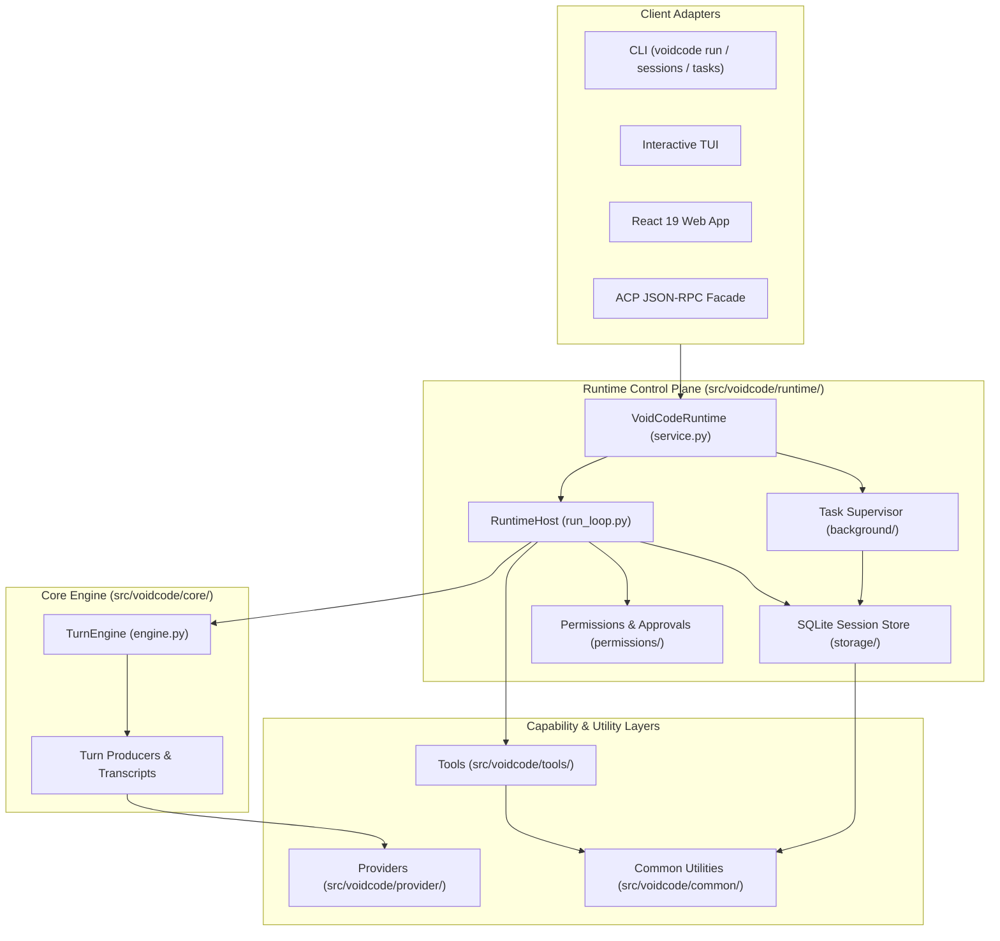

# Architecture Overview

VoidCode is a local-first coding agent runtime designed around clear separation of responsibilities, append-only persistence, and configurable runtime governance.

## Core Design Principles

1. **Separation of Governance and Turn Progression**:
   The runtime control plane (`src/voidcode/runtime/`) owns all system truth: session state, permissions, approvals, tool registry scoping, hooks, persistence, and recovery. The core turn engine (`src/voidcode/core/`) is completely host-agnostic: it advances provider conversations and tool batches without direct knowledge of SQLite, HTTP transports, or user interfaces.

2. **Seam Adapter (`RuntimeHost`)**:
   `RuntimeHost` (in `src/voidcode/runtime/run_loop.py`) bridges core turn progression with runtime governance. When `TurnEngine` plans tool calls, `RuntimeHost` evaluates permissions against the active approval mode, executes tools within runtime-managed workspace context, and records events to durable storage.

3. **Append-Only Event Sourcing**:
   Session history is stored as an immutable, monotonic stream of events in a local SQLite database (`session_events`). Current session views, transcript projections, and replay checkpoints are derived from this event stream.

4. **Hierarchical Task Delegation**:
   A primary session can spawn child sessions using the `task` tool. Child tasks run with specialized agent presets (`explore`, `review`, `research`, `execute`, `plan`), maintain parent-child linkage in storage, and report structured results back to the parent.

## Architecture Diagram

## Subsystem Details

### 1. Runtime Control Plane (`src/voidcode/runtime/`)
The runtime is the central authority for execution:
- **`service.py` (`VoidCodeRuntime`)**: Main entry point for starting runs, streaming responses, resuming sessions, managing background tasks, and handling approvals.
- **`run_loop.py` (`RuntimeHost`)**: Coordinates turn execution, invokes provider models, dispatches tool calls, and records state checkpoints.
- **`storage/`**: SQLite-backed persistence storing sessions, event streams, background tasks, and provider catalog caches.
- **`permissions/`**: Evaluates tool permissions against configured approval modes (`ask`, `write`, `yolo`) and static effect tiers.
- **`background/`**: Manages background task worker threads, execution leases, and completion queues.
- **`transport/`**: FastAPI HTTP application providing REST endpoints and Server-Sent Events (SSE) streaming.

### 2. Core Turn Engine (`src/voidcode/core/`)
Host-agnostic turn progression engine:
- **`engine.py` (`TurnEngine`)**: Drives the turn progression loop. Given a turn request and a host, it requests completions from injected producers (such as `ProviderTurnProducer`, which handles provider API communications), yields streamed chunks, and submits tool batches back to the host. The engine does not own session storage or transport state.
- **`transcript.py`**: Context segment models, tool result projections, and transcript assemblers.
- **`turns.py`**: Definitions of model turns, tool turns, turn plans, and turn facts.

### 3. Tools Layer (`src/voidcode/tools/`)
Contains built-in tool implementations registered with the runtime:
- File & editing tools: `read`, `write`, `edit`, `apply_workspace_edit`.
- Navigation & search: `glob`, `grep`, `ast_grep`.
- Command execution: `shell_exec`.
- Delegation: `task`, `task_batch`.
- Session & capabilities: `background_process`, `question`, `todo`, `skill`, `lsp`, `web_fetch`, `web_search`.

### 4. Common Utilities Layer (`src/voidcode/common/`)
Responsible for shared data modeling, snapshotting, limits, and template parsing:
- **`json_values.py`**: Immutable JSON snapshotting (`own_json_value`) and wire format projections (`json_wire_object`).
- **`frontmatter.py`**: YAML frontmatter parsing for prompt commands and agent configurations.
- **`output_limits.py`**: Shared diagnostic output limits and string truncation (`truncate`).
