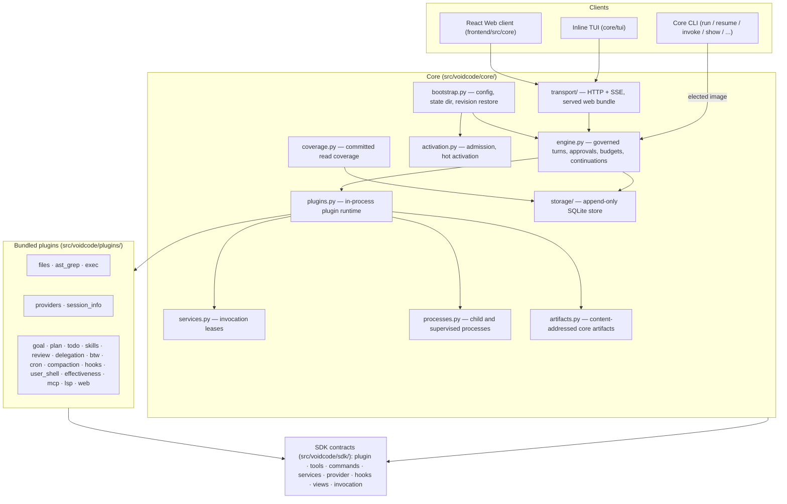

# Architecture Overview

VoidCode is a local-first coding agent built as a small trusted **core**, a **plugin SDK**, and a bundled plugin set that owns every product mechanism. Execution is durable and append-only, revisions identify configuration and composition, and clients talk to the core through one generic command/view/event contract rather than product-specific routes.

## Core Design Principles

1. **Trusted Core, Trusted Plugins**:
   The core (`src/voidcode/core/`) owns governance, persistence, streaming, and admission. Plugins own behavior — tools, commands, providers, hooks, views, and session state — and reach the core only through the SDK's scoped services. Nothing in the core imports a concrete plugin. Plugins are trusted code equal to the application: an admitted plugin is trusted Python running in the core's process, and only source code the user configured is ever loaded. This is an architecture boundary, not a sandbox.

2. **Contracts-Only SDK**:
   `src/voidcode/sdk/` is the single shared surface for the core and every plugin, and it depends on nothing from the implementation layers (standard library, `pydantic`, and `jsonschema` only).

3. **Revisions, Never Implicit Change**:
   A restart imports the current plugin source with the recorded configuration; changed configuration, a changed SDK, or a different image is never admitted implicitly. It refuses to restart against an old revision; the explicit path is the controlled core upgrade (`voidcode upgrade run --candidate`, see [`core-upgrade.md`](./contracts/core-upgrade.md)), and a hot reload never crosses an SDK or image change.

4. **Append-Only Durability**:
   Session history is an immutable, monotonic event stream in SQLite. Views, transcripts, usage reports, and plugin-provided UI are projections of that stream. There is no fork, undo, revert, or checkout.

5. **Declarative Clients**:
   Clients (CLI, TUI, web) never hard-code product commands. They read the admitted command catalog and render bounded, typed plugin views, binding every action to the revision it was displayed under.

## Architecture Diagram

## Subsystem Details

### Core (`src/voidcode/core/`)

- **`engine.py` (`Core`)** — the authority for a run: it plans against admitted tools, classifies tool effects (`READ`, `WRITE`, `EXECUTE`, `SPAWN`, `SESSION`), applies policy (`policy.approval_mode` ∈ `ask` / `write` / `yolo` plus `policy.read_only`), gates externally mutating work, appends durable events and checkpoints, drives durable continuations, and settles cancellations and budget exhaustion. Reserved core commands such as `core.reload` are dispatched through the same typed command contract plugins use.
- **`bootstrap.py`** — product wiring: reads `voidcode.json`, computes the per-workspace state directory, adopts a first revision or restores the persisted one (refusing when the installed SDK no longer matches the active revision), and verifies the workspace is not owned by another core before writing.
- **`activation.py`** — admission and revision management: source resolution, private configuration snapshots, and state migration/deactivation plans for capability switches.
- **`plugins.py` (`PluginRuntime`)** — the in-process plugin runtime: loads each configured plugin package (`__init__.py:create_plugin`) under a unique namespace per generation, and dispatches tool, command, provider, hook, view, observer, and migration calls by direct synchronous call. Cancellation is cooperative: a hung plugin blocks its dispatch until the core restarts.
- **`services.py` (`RuntimeServices`)** — scoped services bound to one invocation lease: state staging, events, child sessions, governed tool requests, process spawning, usage. Read-only and hook leases are refused mutating work here, never in plugins.
- **`processes.py` (`ProcessRegistry`)** — core-owned child processes: one-shot runs (killed by process group on timeout or cancellation), supervised background jobs partitioned by the session that started them (which survive a reload), and generation-owned service processes (which a reload stops).
- **`storage/` (`store.py`, `schema.sql`)** — the append-only SQLite store: sessions, events, checkpoints, revisions, confirmations, claims, and sessions facts.
- **`transport/`** — `http.py` serves the core API (`/api/...`), `models.py` holds its wire models, `server.py` binds loopback with a bearer token printed at launch, `static.py` locates the built web bundle served at `/`.
- **`tui/`** — the inline terminal client (`catalog → invoke → events → views`) with a commit-once ledger: settled rows are never replayed.
- **`artifacts.py` / `coverage.py`** — content-addressed artifacts the core owns under its state directory, and the derived record of what a session's model has genuinely been shown (whole-file and line-precise reads only).

### SDK (`src/voidcode/sdk/`)

The shared vocabulary: `plugin.py` (`Plugin` registration: tools, commands, providers, views, context, observers, lifecycle, pre/post tool, state schema, migration, close), `tools.py`, `commands.py` (command descriptors, results, confirmations, catalog), `invocation.py` (`ToolContext`), `services.py` (`PluginServices`: state, events, child sessions, governed tool requests, process spawning, usage), `provider.py` (wire-agnostic turn providers), `hooks.py` (context contributions, facts, lifecycle), `views.py` (the eight bounded UI kinds), `config.py` (`voidcode.json` schema), `codec.py` / `json_values.py` / `limits.py` (strict JSON boundary and shared bounds).

### Bundled plugins (`src/voidcode/plugins/`)

Each plugin directory is a Python package admitted by the same rules as a third-party plugin. The bundled set provides:

| Plugin | Contributes |
|---|---|
| `files` | `read`, `write`, `edit`, `glob`, `grep`, `apply_workspace_edit` |
| `ast_grep` | `ast_grep` structural search |
| `exec` | `shell_exec`, `background_process` |
| `web` | `web_fetch`, `web_search` |
| `lsp` | `lsp` tool and `/lsp` command |
| `mcp` | `mcp` tool and `/mcp` inventory |
| `providers` | turn providers for OpenAI-compatible, Anthropic, and Google families, plus `/model` and `/providers` panels |
| `session_info` | `/session_status`, `/context`, `/usage`, `/export`, `/copy` |
| `todo` | `todo` tool, `/todo`, `/todo.clear` |
| `plan` | `/plan`, `/plan.off`, `/plan.status` collaboration mode |
| `skills` | `skill` tool and `/skills` |
| `review` | `/review` |
| `delegation` | `task`, `task_batch` (agent-facing delegation) plus `/agents`, `/agents.show` profiles |
| `btw` | `/btw` side question |
| `cron` | `cron_create`, `cron_delete`, `cron_list`, `/loop` |
| `compaction` | `/compact` context compaction |
| `hooks` | lifecycle hook execution |
| `user_shell` | `/shell` user shell escape |
| `effectiveness` | `/effectiveness` session-scoped metrics |
| `goal` | thread goal tools and `/goal*` commands |

Which ids are admitted by default is decided in `core/bootstrap.py` (`_bundled_sources`); any additional id needs an explicit `plugins.<id>.path`.

### Tool boundary

Model tools are SDK contracts plus owner-registered handlers: each plugin's
`create_plugin` returns `Plugin.tools` with definitions next to the handlers,
the runtime serves them as the init catalog, and the
core admits, validates, approves, dispatches, and records every call. The
engine-owned model tool `core_reload` is not plugin-declared; `core.reload`
is the corresponding user command. Product tools belong in plugins, not in a
legacy tools directory.
`read` also serves bounded derived views: `voidcode://tool/<name>` renders the definition the
core's active dispatch snapshot advertises to this session (plugin plus reserved core tools,
with profile scope and read-only stance applied); `voidcode://transcript/<session>` composes a
payload-stripped page from committed events for the caller's own session or one of its own
descendants (parents, siblings, unrelated roots, and foreign workspaces are refused by the
core's lineage guard); `voidcode://rule/<name>` asks the skills plugin's `workspace.rule_page`
query, which owns the rulebook semantics; `voidcode://artifact/<id>` reads through
`PluginServices.read_artifact`. `apply_workspace_edit` demands `expectedHash`, and version
constraints are checked against the LSP plugin's `workspace.document_version` query — a pure
read of documents this session already opened (never a server start) — failing closed with a
visible diagnostic when nothing is open. Language servers run as supervised runtime-generation
service processes (`spawn_service_process`, stdin piped, stdout/stderr spooled) so retirement,
reload, cancellation, and hard core death all clean the owned tree; the `lsp` tool therefore
declares `read`+`execute` and flows through the existing approval/read-only gates.

## Execution & Durability Model

1. **One authority, append-only facts.** A run appends `kernel.*` events; the session view, transcript, usage report, pending confirmations, and plugin views are all derived from those rows. A client that reconnects replays the stream and commits each row at most once. (The `kernel.*` event prefix is the immutable history vocabulary and stays after the kernel→core rename.)
2. **Capability revisions.** The admitted plugin generation is a revision. Commands and views are read with the revision they were captured under, and actions are submitted with the revision the client displayed; a stale revision is refused rather than executed against a different generation. `core.reload` commits a new revision and emits `kernel.activation_committed`.
3. **Two distinct gates.** A *native tool approval* (`kernel.approval_requested`) is resolved by resuming the session with the exact approval request id. A *plugin action confirmation* (`kernel.confirmation_requested`) is resolved against the stored confirmation record through the confirm endpoint with the displayed revision. Clients never conflate them.
4. **Recovery is restore, not replay.** A restart restores the persisted revision and its private snapshot; interrupted mutations are never replayed, and a provider dispatch that never completed settles as unknown usage rather than a fabricated zero.

## Client Surfaces

- **Core CLI** (`python -m voidcode.core`, also the `voidcode` console script): `run`, `resume`, `show`, `preflight`, `create-session`, `sessions`, `catalog`, `invoke`, `confirm`, `views`, `drain`, `usage`, `serve`, `upgrade`, and the bare command. The operational commands execute inside the elected image; `show` is a config-free SQLite rescue reader; `serve` supervises one core child behind a stable endpoint and token; the bare command opens the TUI against a supervisor child by default and drives it as an HTTP client (or attaches to a remote one with `--server`); `upgrade` asks the running supervisor for a controlled core upgrade and `preflight` prints the read-only candidate check.
- **TUI**: inline scrollback with a commit-once ledger; local controls (`/tui help|sessions|session|new|views|cancel|quit`) that never shadow an admitted command.
- **HTTP/SSE**: the generic `/api` contract — see [`contracts/client-transport.md`](./contracts/client-transport.md).
- **Web client** (`frontend/src/core/`): the React core app, served by the core at `/` when a bundle is built, rendering the same catalog, views, and event stream.

## State Directory

`$XDG_STATE_HOME/voidcode/kernel-v1/<sha256-of-workspace-path>/` (default `~/.local/state/...`) holds:

- `kernel-v1.sqlite3` — sessions, events, checkpoints, revisions, confirmations;
- `private/<revision>.json` — the 0600 configuration snapshot (credentials included), never referenced by events or revisions;
- `kernel-images/<digest>/` — immutable installation snapshots; the elected image a revision pins resolves here;
- `supervisor/` — the supervisor's journal and scratch (observability only; SQLite stays canonical). The control socket is ephemeral under `/tmp/voidcode-<uid>/`, derived from the state directory.

The state directory must not live inside the workspace; `--state-dir` overrides the derived location. Legacy state from the pre-core architecture is neither read nor migrated.
