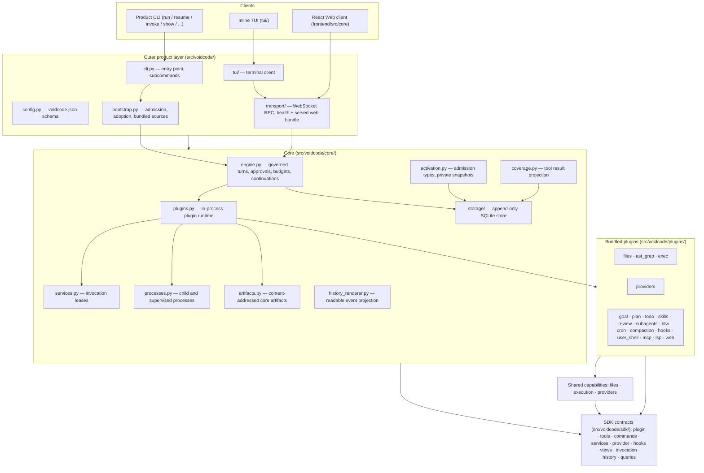

# Architecture Overview

VoidCode is a local-first coding agent built as a small trusted **core**, a **plugin SDK**, shared product capabilities, an outer product layer, and a bundled plugin set. Execution is durable and append-only, revisions identify configuration and composition, and clients talk to the core through one generic command/view/event contract rather than product-specific routes.

## Core Design Principles

1. **Trusted Core, Trusted Plugins**:
   The core (`src/voidcode/core/`) owns governance, persistence, streaming, activation, and the in-process plugin runtime. Files, shell execution, and model providers are ordinary plugins with zero builtins and zero fallback: a zero-plugin core manages sessions and SQLite persistence only. Plugins add tools, commands, providers, hooks, views, queries, and state. Both use the SDK's scoped services. Nothing in the core imports a concrete plugin, a capability module, or any product/CLI/UI/HTTP adapter. Plugins are trusted code equal to the application: an admitted plugin is trusted Python running in the core's process, and only source code the user configured is ever loaded. This is an architecture boundary, not a sandbox.

2. **Contracts-Only SDK**:
   `src/voidcode/sdk/` is the single shared surface for the core and every plugin, and it depends on nothing from the implementation layers (standard library, `pydantic`, and `jsonschema` only). It holds no configuration schema, no workspace query contracts, and no state migration hook; history paging uses the `HistoryEvent`/`HistoryPage` bounds in `sdk/history.py` and the `read_child_history`/`read_session_history` services.

3. **Revisions, Never Implicit Change**:
   A restart imports the current plugin source with the recorded configuration; changed configuration is never admitted implicitly. `core.reload` re-admits the live file as a new revision in-session; pointing `--state-dir` at a fresh directory adopts the current file as a first revision. A hot reload never crosses an SDK or image change.

4. **Append-Only Durability**:
   Session history is an immutable, monotonic event stream in SQLite (schema v6). Views, transcripts, usage reports, and plugin-provided UI are projections of that stream. There is no fork, undo, revert, or checkout. A database at any other schema version (including legacy v5) is refused read-only; nothing is migrated or deleted automatically.

5. **Declarative Clients**:
   Clients (CLI, TUI, web) never hard-code product commands. They read the admitted command catalog and render bounded, typed plugin views, binding every action to the revision it was displayed under.

## Architecture Diagram

## Subsystem Details

### Core (`src/voidcode/core/`)

- **`engine.py` (`Core`)** — the authority for a run: it plans against admitted tools, classifies tool effects (`READ`, `WRITE`, `EXECUTE`, `SPAWN`, `SESSION`, `NETWORK`), applies the neutral execution policy (`approval_mode` ∈ `ask` / `write` / `yolo` plus `read_only`), gates externally mutating work, appends durable events and checkpoints, drives durable continuations, and settles cancellations and budget exhaustion. Reserved core commands (`run`, `resume`, `show`, `status`, `help`, `core.reload`) and the reserved `core_reload` tool are dispatched through the same typed command/tool contracts plugins use.
- **`activation.py`** — neutral admission types (`Admission`, `ExecutionConfig`, `ExecutionPolicy`, `SandboxPolicy`), private configuration snapshot storage, and state validation/deactivation plans for capability switches. No product configuration concepts live here.
- **`plugins.py` (`PluginRuntime`)** — the in-process plugin runtime: loads each configured plugin package (`__init__.py:create_plugin`) under a unique namespace per generation, and dispatches tool, command, provider, hook, view, observer, and query calls by direct synchronous call. Cancellation is cooperative: a hung plugin blocks its dispatch until the core restarts.
- **`services.py` (`RuntimeServices`)** — scoped services bound to one invocation lease: state staging, events, child sessions, governed tool requests, process spawning, usage, bounded history pages, artifacts. Read-only and hook leases are refused mutating work here, never in plugins.
- **`processes.py` (`ProcessRegistry`, `ProcessHost`)** — core-owned child processes. `ProcessHost` is the Core-lifetime supervisor for detached background jobs and their stable `state_dir/process-spool` logs: every runtime generation shares it, so reloads keep jobs listable/readable/writable/stoppable and only `Core.close()` stops them; exited entries are retained up to a small per-owner/session cap. `ProcessRegistry` owns one-shot runs (killed by process group on timeout or cancellation) and generation-owned service processes (stopped on reload), delegating background operations to the shared host. When a `SandboxBackend` is present, every spawn runs under OS-enforced confinement; the backend is transparent — plugins make zero sandbox changes.
- **`sandbox.py` (`SandboxBackend`)** — the transparent exec backend: helper argv + explicit env + protected paths built from the neutral policy, availability probe, and supervisor report decoding. Enforcement lives in the native helper (`native/sandbox-adapter/`); observation (snapshot-diff changes) stages onto the lease for the engine to merge.
- **`storage/` (`store.py`, `schema.sql`)** — the append-only SQLite store: sessions, events, checkpoints, revisions, confirmations, claims, and session facts. Schema v6.
- **`artifacts.py` / `coverage.py`** — content-addressed artifacts the core owns under its state directory, and bounded tool result projections and canonical resource paths.
- **`history_renderer.py`** — the readable Markdown projection of committed events (`core.*` shapes), shared by the core's immutable child-history snapshot and the bounded history services. It depends on the SDK only.

### Outer product layer (`src/voidcode/`)

- **`cli.py`** — the product CLI entry point (`voidcode` console script and `python -m voidcode`): `run`, `resume`, `show`, `create-session`, `sessions`, `catalog`, `invoke`, `confirm`, `views`, `drain`, `usage`, `serve`, and the bare command (in-process local TUI server, or `--server`/`--token` for a remote one). `show` is a config-free SQLite rescue reader.
- **`config.py`** — the product `voidcode.json` schema (`Config`), strict parser, and flat provider resolution (explicit fields plus the `<PROVIDER>_API_KEY` environment key).
- **`bootstrap.py`** — admission assembly (`admit_live`, `open_core`), generation adoption, the bundled plugin id list (`BUNDLED_PLUGIN_IDS`), and the private-snapshot lifecycle.
- **`transport/`** — `http.py` serves the core API (`/api/...`), `models.py` holds its wire models, `server.py` binds loopback with a bearer token printed at launch, `static.py` locates the built web bundle served at `/`.
- **`tui/`** — the inline terminal client (`catalog → invoke → events → views`) with a commit-once ledger: settled rows are never replayed. `client.py` streams events as a direct async generator over `httpx.AsyncClient`; the UI thread owns a worker loop with task cancellation and generation isolation.

### SDK (`src/voidcode/sdk/`)

The shared vocabulary: `plugin.py` (`Plugin` registration: tools, commands, providers, views, queries, resource readers, context, observers, lifecycle, pre/post tool, state schema, deactivation, close), `tools.py`, `commands.py` (command descriptors, results, confirmations, catalog), `invocation.py` (`ToolContext`), `resources.py` (`ResourceReader`: typed `scheme://` handlers answered under a provider-owner read lease, with `ResourceUnavailable` for unregistered schemes), `services.py` (`PluginServices`: state, events, child sessions, governed tool requests, process spawning, usage, bounded history, artifacts, plus the optional-query transport and its `QueryUnavailable`/`QueryContractError` errors), `provider.py` (wire-agnostic turn providers), `hooks.py` (context contributions, facts, lifecycle), `views.py` (the eight bounded UI kinds), `history.py` (`HistoryEvent`, `HistoryPage`, page bounds), `codec.py` / `json_values.py` / `limits.py` (strict JSON boundary and shared bounds).

### Bundled plugins (`src/voidcode/plugins/`)

Each plugin directory is a Python package admitted by the same rules as a third-party plugin. Each documents its own surface, configuration, behavior, and limits in its package README (indexed once in [docs](README.md#plugins)). The bundled set provides:

| Plugin | Contributes |
|---|---|
| `files` | `read`, `write`, `edit`, `glob`, `grep`; `tool://`, `artifact://`, `transcript://` resource readers |
| `ast_grep` | `ast_grep` structural search |
| `exec` | `shell_exec`, `background_process` |
| `web` | `web_search` (multi-backend), `web_fetch` page snapshots, `web://` resource reader |
| `lsp` | `lsp` tool and `/lsp` command |
| `mcp` | `mcp` tool and `/mcp` inventory |
| `providers` | turn providers for OpenAI-compatible, Anthropic, and Google families, plus `/model` and `/providers` panels |
| `todo` | `todo` tool, `/todo`, `/todo clear` |
| `plan` | `/plan`, `/plan off`, `/plan status`; overlay-backed read-only collaboration mode |
| `skills` | `skill://` reader (loaded through the `read` tool), `/skills`, `/skills.show`, and workspace rule context (`AGENTS.md` hierarchy + `.voidcode/rules`) |
| `review` | `/review` |
| `subagents` | `task`, `task_batch` (agent-facing delegation) plus `alt+a` subagent monitor |
| `btw` | `/btw` side question |
| `cron` | `cron_create`, `cron_delete`, `cron_list`, `/loop` |
| `compaction` | `/compact` context compaction |
| `hooks` | lifecycle hook execution |
| `user_shell` | `/shell` user shell escape |
| `goal` | thread goal tools and `/goal*` commands |
| `workflows` | `workflow_run` tool, `/workflow <run\|status\|pause\|resume\|cancel>` commands, scripted child-session graphs |

Which ids are admitted by default is decided in `bootstrap.py` (`BUNDLED_PLUGIN_IDS`); any additional id needs an explicit `plugins.<id>.path`.

### Tool boundary

Model tools are SDK contracts plus owner-registered handlers: each plugin's
`create_plugin` returns `Plugin.tools` with definitions next to the handlers,
the runtime serves them as the init catalog, and the
core admits, validates, approves, dispatches, and records every call. The
engine-owned model tool `core_reload` is not plugin-declared; `core.reload`
is the corresponding user command. Product tools belong in plugins, not in core.
`edit` accepts exact text replacements (single replacement or ordered batch) and
LSP-style range edits (`mode="range"`) across one or more files. File editing
uses Python filesystem operations and does not require Git; unified diffs are
output previews, not edit input. Text matching is EOL-insensitive, committed
bytes use the file's one uniform ending, mixed-ending files are refused, and
every successful edit reports the changed files' new SHA-256 hashes.

`read` reads regular files and bounded resource URIs. It does not list directories
or parse notebook, PDF, SQLite or archive formats; use shell tools for those
operations and read their text output when needed. The only read arguments are
`path`, `offset`, `limit`, `byte_offset`, `byte_limit` (byte cursors apply only
to artifacts), and `hash_only` (regular file paths). Only an untruncated page
starting at `offset=1` and reaching EOF reports the file's SHA-256 and coverage;
`offset>1` pages never do. Line count is reported whenever the read reaches EOF,
including `offset>1` pages. Partial pages stop after the requested page plus an
EOF probe and never decode unseen later lines; they may read ahead one raw chunk.
`hash_only` streams the whole file to obtain the hash when a page was partial.
Resource URIs use their own schemes, without legacy aliases:
 `tool://<name>` renders the definition the
core's active dispatch snapshot advertises to this session (plugin plus reserved core tools,
with profile scope and read-only stance applied); `transcript://<session>` composes a
payload-included page from committed events for the caller's own session or one of its own
descendants (parents, siblings, unrelated roots, and foreign workspaces are refused by the
core's lineage guard); `artifact://<id>` reads through
`PluginServices.read_artifact(sha256, offset=..., limit=...)`. Producers return the
SDK's immutable `ArtifactReference` directly in `OutputBounds.reference`; its URI
is derived from its digest. Other resource references are URI strings. See
[artifact contracts](./contracts/artifacts.md). `edit` range mode demands `expectedHash`, and version
constraints are checked against the LSP plugin's `workspace.document_version` query — a pure
read of documents this session already opened (never a server start) — failing closed with a
visible diagnostic when nothing is open. Mutating targets must resolve inside the workspace;
`read`/`glob`/`grep` keep external read access. Language servers run as supervised runtime-generation
service processes (`spawn_service_process`, stdin piped, stdout/stderr spooled) so graceful
retirement, reload, and cancellation clean the owned tree; a hard-killed core does not run that
cleanup and leaves an unconfined service running in its own session. The `lsp` tool therefore
declares `read`+`execute` and flows through the existing approval/read-only gates.

## Execution & Durability Model

1. **One authority, append-only facts.** A run appends `core.*` events; the session view, transcript, usage report, pending confirmations, and plugin views are all derived from those rows. A client that reconnects replays the stream and commits each row at most once.
2. **Capability revisions.** The admitted plugin generation is a revision. Commands and views are read with the revision they were captured under, and actions are submitted with the revision the client displayed; a stale revision is refused rather than executed against a different generation. `core.reload` commits a new revision and emits `core.activation_committed`.
3. **Two distinct gates.** A *native tool approval* (`core.approval_requested`) is resolved by resuming the session with the exact approval request id. A *plugin action confirmation* (`core.confirmation_requested`) is resolved against the stored confirmation record through the confirm endpoint with the displayed revision. Clients never conflate them.
4. **Recovery is restore, not replay.** A restart restores the persisted revision and its private snapshot; interrupted mutations are never replayed, and a provider dispatch that never completed settles as unknown usage rather than a fabricated zero.

## Client Surfaces

- **Product CLI** (`python -m voidcode`, also the `voidcode` console script): `run`, `resume`, `show`, `create-session`, `sessions`, `catalog`, `invoke`, `confirm`, `views`, `drain`, `usage`, `serve`, and the bare command. The operational commands execute directly; `show` is a config-free SQLite rescue reader; `serve` serves loopback WebSocket RPC plus the built web bundle; the bare command opens the TUI against an in-process local server (or a remote one with `--server`/`--token`).
- **TUI**: inline scrollback with a commit-once ledger; local controls (`/tui help|sessions|session|new|views|cancel|quit`) that never shadow an admitted command.
- **WebSocket RPC**: the generic `/api` contract — see [`contracts/client-transport.md`](./contracts/client-transport.md).
- **Web client** (`frontend/src/core/`): the React core app, served at `/` when a bundle is built, rendering the same catalog, views, and event stream.

## State Directory

`$XDG_STATE_HOME/voidcode/<sha256-of-workspace-path>/` (default `~/.local/state/...`) holds:

- `voidcode.db` — sessions, events, checkpoints, revisions, confirmations;
- `private/<revision>.json` — the 0600 configuration snapshot (credentials included), never referenced by events or revisions;
- `artifacts/` — content-addressed tool-output artifacts owned by the core.

The state directory must not live inside the workspace; `--state-dir` overrides the derived location. Legacy state from the pre-core architecture is neither read nor migrated.

## Zero-plugin operation and optional collaboration

With every bundled plugin disabled, the core still manages sessions and SQLite persistence, but file, shell, and model capabilities are genuinely absent: there are no built-in tools and no fallback providers. Provider credentials are still required when the endpoint requires authentication.

Disabling `files`, `exec`, or `providers` removes those capabilities completely; re-enabling restores them. Duplicate tool names between plugins remain errors.

Plugins collaborate through optional contracts rather than importing a concrete peer.
`voidcode.capabilities.workspace_queries` defines `workspace.document_version`
and its shared request/answer types.
Both sides use the shared `bind` / `ask` helpers rather than duplicating dictionaries and validation. Any plugin
can implement them. `QueryUnavailable` means no provider was admitted; `None` means the
provider knows no such resource. Malformed answers and provider exceptions remain visible
failures. Files can operate without skills or LSP; edits carrying only a content hash remain usable, and
version-constrained edits fail closed without a document version. Discoverable
rules advertise their source files and use ordinary file reads.
This removes duplicated contract definitions, while retaining the explicit semantic dependency
when a caller requests an optional resource. Custom query names remain available to plugins.

Bounded transcript reads use the SDK history services: `PluginServices.read_session_history`
renders a Markdown page for the bound session, and `read_child_history` renders one for an
owned child session; both return the `HistoryPage` cursor (`text`, `next_after_sequence`,
`next_offset`, `truncated`) from `sdk/history.py`.

Workflow profiles also depend on visible tool capabilities rather than a fixed plugin set.
Delegation and review select the available subset of their declared tools. An unavailable
optional tool never causes a retry with the broader parent scope. See
[optional query contracts](contracts/optional-queries.md) for provider authoring and failure semantics.

Plugin observers and historical projections share [public SDK facts](./contracts/facts.md). Tool names identify dispatch; governance effects declare authority and result observations record what happened. Skills consume that contract without inspecting private event payloads or depending on file/subagents/compression plugin names.
